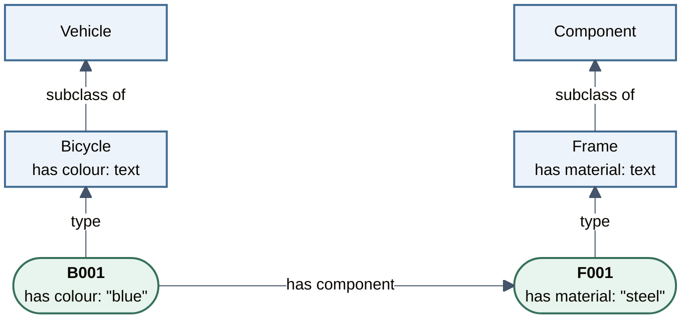

# Design your own ontology

In this chapter, we turn the bicycle example into a small ontology design. Starting from a research purpose and a few inventory records, we decide what the model should describe and work towards a shared understanding of its terms. The result is a sketch with notes on the meanings and identifiers of its terms. We can develop and check it against the records using only pen and paper.

```{admonition} Reuse in practice
:class: note

In practice, check whether existing ontologies or vocabularies can be reused or extended before building your own. Develop new terms for concepts or relationships that suitable existing models do not cover, and combine them with terms you can reuse. Here, we build a small ontology first to understand the modelling choices involved. {cite}`noy2001ontology`
```

## Define the purpose and initial scope

### Starting from a research purpose

The *purpose* explains why we are developing an ontology. It may come from a task researchers want to carry out, such as comparing data from different studies, or from a broader aim to describe research data consistently for future reuse. Discussing these needs with the people who collect and use the data helps establish what the ontology is for. {cite}`noy2001ontology,suarezfigueroa2009requirements`

A *use case* makes a particular intended use concrete: who will use the ontology, what they want to do with the data and why. It gives us a starting point for deciding what to represent. A detailed use case can develop as the research needs become clearer; a broader purpose and representative records can guide the initial model. {cite}`suarezfigueroa2009requirements,uschold1995methodology`

For the {ref}`bicycle example <running-example>`, imagine a research team comparing frame materials across several bicycle inventories. They want to find bicycle records with a specified frame material and bring those records together for analysis. A shared model would help them describe the relationship between each bicycle and its frame, and record the frame's material consistently.

### Working with representative records

We will work with a few *representative records*: examples chosen to show the characteristics and variation the model should cover. They make modelling decisions concrete. We can check whether the model describes the relevant information in each record and whether the same terms work across records.

These fictional inventory records include B001 from the running example and add two bicycles: one with a different frame material and one whose frame material is missing. We can consider each situation as we develop the model:

| Bicycle | Colour | Frame | Frame material |
|---|---|---|---|
| B001 | blue | F001 | steel |
| B002 | red | F002 | aluminium |
| B003 | black | F003 | Not recorded |

“Not recorded” marks a missing value in the table. The {download}`Turtle file <../data/bicycle-inventory.ttl>` leaves F003's material value absent and uses the same classes, properties and prefixes as the earlier graph.

### Setting an initial scope

The *scope* describes what the model covers and in how much detail. Choosing an initial scope helps us concentrate on the information needed for the purpose. {cite}`suarezfigueroa2009requirements` For our comparison, we start with bicycle frames and their recorded materials.

Other components and their materials, detailed alloy composition, material performance, and manufacturing or maintenance histories are outside this initial scope: we do not need them for the comparison.

A short shared description of the purpose, intended users and scope helps the researchers who know the domain and those who will use the data agree what to include. It can be revised as new needs emerge. {cite}`suarezfigueroa2009requirements`

## Refine the scope with competency questions

A *competency question* states something the ontology, together with relevant data, should help answer. Writing these questions is one way to make the purpose and scope more precise: each question helps identify what the model needs to represent and provides a way to check its coverage. {cite}`gruninger1995methodology,noy2001ontology`

### Using competency questions

For the frame-material use case, one competency question is:

> Which bicycles have a frame recorded as steel?

To support this question, the model needs to represent bicycles, frames, the relationship between them and frame material. This refines our initial scope. The data needs to identify the particular bicycles and frames and record each frame's material. The expected result is a list of bicycle identifiers.

This wording identifies the relevant component. Asking about “bicycles made of steel” would leave it unclear whether the frame, wheels or another part determines the selection. Recording the intended result alongside the question helps make that requirement precise. {cite}`suarezfigueroa2009requirements`

Competency questions can also concern information inferred from the model. For example, “Which recorded objects can be classified as vehicles?” can include objects recorded as bicycles when the ontology states that every Bicycle is a Vehicle. We keep this classification from our example. {cite}`gruninger1995methodology,w3c2012owl2primer`

Checking the frame-material question against our representative records can reveal missing data as well as modelling gaps. For F003, recording its material would fill a gap in the data; the model already provides a way to represent it.

### Developing questions over time

You can also begin with a use case, representative records or an initial sketch, and develop questions as the intended use becomes clearer. Early modelling can focus on agreeing the important concepts when detailed questions would be too specific. An initial set of questions can be small and grow with discussion. {cite}`uschold1995methodology,noy2001ontology`

For research aimed at future reuse, this means agreeing which main characteristics and relationships to cover while specific research questions are still emerging. {cite}`uschold1995methodology` Here, we retain the bicycle's colour for broader inventory reuse, although it is not needed to select records by frame material. Linked Data can also support combinations across research fields that the data's publishers did not anticipate. {cite}`bernerslee2004connectingsciences` Competency questions provide examples for checking coverage; they do not need to anticipate every future use.

## Shared conceptualisation and drawing

With an initial scope and representative records, we can develop a *conceptual model*: a description of the kinds of things in the domain, their relationships and the data values we want to record about them. A sketch and short written explanations give people something concrete to discuss and revise as they work towards a *shared conceptualisation*: an agreed understanding of the model's concepts and relationships. {cite}`uschold1995methodology`

People who know a domain well may still disagree about what a familiar term includes. {cite}`neuhaus2022consensus` People who collect and interpret the data, as well as those who will reuse it, bring different examples and explanations to this discussion. These can reveal distinctions that one modeller might overlook. Involving them helps make different research practices and needs explicit. {cite}`hocker2020participatory`

For example, one colleague might use *bicycle* only for vehicles powered entirely by the rider, while another includes electric assistance. Discussing a concrete example helps them agree what belongs in the model's Bicycle class. A possible agreement is to include two-wheeled cycles designed to be pedalled, with or without electric assistance. Keeping the agreed meaning alongside the example makes the decision understandable to others.

A visible sketch helps everyone refer to the same model during discussion. Unresolved points can be noted for a later discussion. {cite}`uschold1995methodology,neuhaus2022consensus`

### Classes, properties and data values

The bicycle records give us concrete things to describe. OWL distinguishes the following elements, which we can already use when sketching the model. {cite}`w3c2012owl2primer`

| Element | What it represents | Example |
|---|---|---|
| Class | A kind of thing | Bicycle, Vehicle or Frame |
| Individual | A particular thing; an instance of a class | B001 is an instance of Bicycle; F001 is an instance of Frame |
| Object property | A property that represents a relationship between individuals | “has component” links B001 to F001 |
| Datatype property | A property that links an individual to a data value | “has material” links F001 to “steel” |
| Data value | Text, a number or another value, represented by a *literal* in RDF | “blue” and “steel” are text values |

Bicycle is one class used to describe B001, B002 and B003; each identifier names a particular bicycle. Frame is another class, used for F001, F002 and F003. Keeping classes and individuals distinct lets the same model describe many records.

For this use case, “steel” and “aluminium” are values of the “has material” property. Different recorded materials can be described using the same Frame class. Agree how to write these values across inventories; using “steel” consistently makes records easier to match. A separate class is useful when the model needs to distinguish a kind of thing, rather than simply record a different value. {cite}`noy2001ontology`

A *subclass* is a more specific class. Bicycle is a subclass of Vehicle: every instance of Bicycle is also an instance of Vehicle. Frame is a subclass of Component, which covers physical parts of objects. A component relationship has a different meaning. F001 is a component of B001; making Frame a subclass of Bicycle would say that every frame is itself a bicycle. {cite}`w3c2012owl2primer`

### Sketch the model

The following sketch combines the model with one record so we can see how its parts are used. We use square-cornered boxes for classes and rounded boxes for individuals. These are drawing conventions for this course; other shapes work too, as long as classes and individuals are clearly distinguishable and the arrows have clear meanings.

1. We begin with the classes Bicycle and Frame. Vehicle sits above Bicycle and Component above Frame, with arrows labelled “subclass of”: every bicycle is a vehicle, and every frame is a component.
2. Inside the class boxes, we list datatype properties and the kinds of values we plan to record: “has colour: text” in Bicycle and “has material: text” in Frame. The frame's material belongs with Frame because it describes that component.
3. Below the classes, we add the example individuals B001 and F001. Arrows labelled “type” show class membership, as in the RDF graph. B001 links to F001 through “has component”; their recorded values appear inside their boxes. The same property can link a bicycle to its wheels or other parts.



### Domains, ranges and datatypes

A property's *domain* specifies a class that all its subjects belong to; an object property's *range* specifies a class that all its objects belong to. For “has component”, we use OWL's built-in class `owl:Thing`, which contains every individual, as the domain and Component as the range. This domain also covers objects other than bicycles. From “B001 has component F001”, an application using OWL reasoning (a *reasoner*) can infer that F001 is a Component, even without a recorded class membership. We record B001's Bicycle membership separately. F001's recorded membership in Frame gives its more specific type. {cite}`w3c2012owl2primer`

The Component range covers frames, wheels and other physical parts. Checking that every bicycle has a recorded component is a data-validation task.

For a datatype property, the range is a datatype. We use `rdf:langString` for “has colour” and “has material” because their values are language-tagged text, such as `"steel"@en`. The `rdf:` prefix abbreviates `http://www.w3.org/1999/02/22-rdf-syntax-ns#`. [RDF literals](https://www.w3.org/TR/rdf11-concepts/#section-Graph-Literal)

For numbers, use a numeric datatype: `xsd:integer` represents whole numbers. The `xsd:` prefix abbreviates `http://www.w3.org/2001/XMLSchema#`. In Turtle, `^^` attaches a datatype: `"2"^^xsd:integer` is equivalent to `2`. [Turtle literals](https://www.w3.org/TR/turtle/#literals)

### Check the shared sketch against the records

A useful check is to read each arrow as a sentence. For example: “B001 is a Bicycle”, “every Bicycle is a Vehicle” and “B001 has component F001”. We can follow the link to F001 to find the frame's material. This *sentence test* helps check that the arrows express the intended meaning and that the information describes the right thing. It works when reviewing a sketch yourself or discussing it with colleagues.

The same classes and properties should also describe B002 and F002, with their different colour and material values. F003 remains a Frame while its material is unrecorded. Its example box can show the class membership and leave the material value absent.

Comparing two sketches using the same record helps explain the consequences of each choice. For example, writing “has material: steel” inside B001's box would leave the relevant component unspecified. Keeping F001 as a separate individual makes the frame and its material explicit. When a record exposes a missing distinction, we can revise the sketch. {cite}`noy2001ontology` Marking changes in another colour can help others follow the revision.

The agreed sketch is most useful alongside short explanations of its concepts and relationships, the reasons for important choices, and any unresolved points. These notes preserve the reasoning behind the model for the people who will use or change it. {cite}`uschold1995methodology`

## Lexicalisation: labels, definitions and language tags

Clear labels and definitions help other researchers understand and reuse an ontology. Here, *lexicalisation* covers choosing labels and writing textual definitions. Develop and refine labels and definitions together with domain experts as part of the shared conceptualisation, alongside the sketch. Drafting, discussing and refining that wording can take a substantial part of ontology development: it makes the agreed meaning explicit and can reveal differences in understanding that still need to be resolved. {cite}`uschold1995methodology,neuhaus2022consensus`

### Choose clear labels and definitions

Choose short, recognisable labels using words familiar to the intended users. Use the same naming conventions throughout the model. Here, class labels are singular nouns such as “bicycle” and “frame”; property labels such as “has component” express how they are used in a statement. {cite}`noy2001ontology`

Write a concise definition for each class and property. A useful class definition starts with a broader kind of thing and states what distinguishes members of the class. Use other, already understood terms to explain the meaning; repeating the label, as in “a bicycle is a type of bicycle”, leaves the reader with the same uncertainty. [Textual definitions](https://obofoundry.org/principles/fp-006-textual-definitions.html)

For a property, explain what it relates or records. For a relationship, make its direction clear. The following definitions describe one class and one property from our sketch:

| Label | Definition |
|---|---|
| bicycle | A vehicle with two wheels, designed to be propelled by pedalling, with or without electric assistance. |
| has component | Relates an object to one of its physical parts. |

The Bicycle definition preserves our agreement about electric assistance. The property definition tells us how to read the link from B001 to F001. Use the sketch and representative records to discuss the wording and agree its meaning together. Where a definition is taken or adapted from an existing source, record that source alongside it.

### Add language tags

Add a *language tag* to labels, textual definitions and other natural-language text, such as material names. In Turtle, `"bicycle"@en` is text tagged as English and `"fiets"@nl` as Dutch. Both can be used as labels for the same Bicycle class. Applications can use these tags to select text in a user's preferred language. [RDF labels and language tags](https://www.w3.org/TR/rdf-schema/#ch_label)

Choose the languages needed by the intended users. When providing translations, keep the intended meaning consistent across languages.

## Choose an IRI strategy

An *IRI strategy* sets a consistent pattern for creating identifiers. For new IRIs, choose a Web domain that can be maintained over time, use HTTPS and plan how looking them up will retrieve descriptions, as discussed in {ref}`Linked Data Foundations <linked-data-foundations>`. {cite}`w3c2017dwbp`

Our example uses:

| Identifies | IRI |
|---|---|
| Ontology | `https://example.org/bike` |
| Class | `https://example.org/bike/def/Bicycle` |
| Property | `https://example.org/bike/def/hasComponent` |
| Individual | `https://example.org/bike/id/B001` |

Here, `bike` gives the example's context, `def` groups class and property definitions, and `id` groups individuals. Appending a *local name*, such as `Bicycle`, to the *namespace IRI* `https://example.org/bike/def/` gives the term IRI `https://example.org/bike/def/Bicycle`.

In our example, class local names start with an uppercase letter and property local names with a lowercase letter; subsequent words are capitalised, as in `hasComponent`. Choose property local names that make the direction from subject to object clear: `id:F001 def:hasMaterial "steel"@en .` reads as “F001 has material steel”.

Keep IRIs stable when revising labels or adding translations, and preserve existing IRIs when reusing terms.
