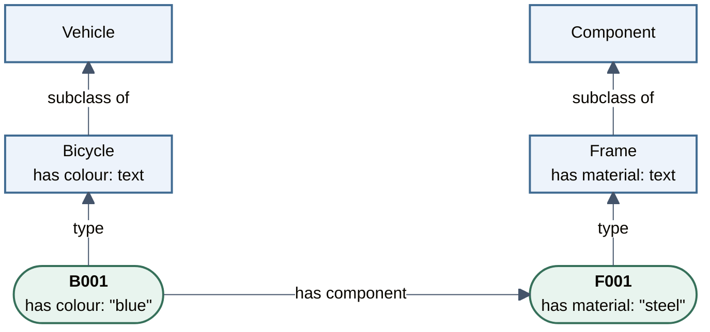

# Design your own ontology

:::{admonition} Learning objectives
:class: note

By the end of this chapter, you will be able to:

- Define a research purpose and initial scope for an ontology.
- Formulate competency questions and state the expected answers for representative records.
- Sketch a conceptual model and use it to describe representative records.
- Write labels and definitions that express agreed term meanings, with language tags for the intended languages.
- Choose a consistent IRI pattern for the ontology, its terms and the things it describes.
:::

We will design a small ontology for comparing frame materials across bicycle inventories, using representative records and a sketch. You can work with pen and paper.

(ontology-development-workflow)=
## An iterative workflow

Work in small cycles with the people who collect, interpret and reuse the data:

1. Agree the research purpose and initial scope.
2. Develop shared terms and definitions, and assess existing ontologies for reuse.
3. Build a small model and use it to describe representative records.
4. Review the descriptions, answers to relevant questions and inferred conclusions together. Revise the model or address gaps in the data as needed.
5. Document decisions, share the model and agree who will maintain it.

As understanding and research needs develop, the cycle repeats. Comparing each revision with the earlier examples shows whether it still covers them. This iterative approach is also described in *Ontology Development 101*. {cite}`noy2001ontology` The {ref}`optional reading <ontology-development-guidance>` offers further guidance and examples.

```{admonition} Reuse in practice
:class: note

Assessing existing ontologies and vocabularies before building can reveal terms or models to reuse or extend. New terms can fill the remaining gaps alongside reused terms. Here, we build a small ontology first to understand the modelling choices involved. {cite}`noy2001ontology`
```

## Define purpose and initial scope

### Starting from a research purpose

The *purpose* explains why we are developing an ontology. It may come from a task researchers want to carry out, such as comparing data from different studies, or from a broader aim to describe research data consistently for future reuse. Discussing these needs with the people who collect and use the data helps establish what the ontology is for. {cite}`noy2001ontology,suarezfigueroa2009requirements`

A *use case* makes a particular intended use concrete: who will use the ontology, what they want to do with the data and why. It gives us a starting point for deciding what to represent. {cite}`suarezfigueroa2009requirements,uschold1995methodology`

For the {ref}`bicycle example <running-example>`, imagine a research team comparing frame materials across several bicycle inventories. They want to find bicycle records with a specified frame material and bring those records together for analysis. A shared model would help them describe the relationship between each bicycle and its frame, and record the frame's material consistently.

### Working with representative records

We will work with a few *representative records*: examples chosen to show the characteristics and variation the model should cover. We can check whether the model describes the relevant information in each record and whether the same terms work across records.

These fictional inventory records include B001 from the running example and add two bicycles: one with a different frame material and one whose frame material is missing. We can consider each situation as we develop the model:

| Bicycle | Colour | Frame | Frame material |
|---|---|---|---|
| B001 | blue | F001 | steel |
| B002 | red | F002 | aluminium |
| B003 | black | F003 | Not recorded |

“Not recorded” marks a missing value in the table. The {download}`Turtle file <../data/bicycle-inventory.ttl>` leaves F003's material value absent and uses the same classes, properties and prefixes as the earlier graph.

### Setting an initial scope

The *scope* describes what the model covers and in how much detail. Choosing an initial scope helps us concentrate on the information needed for the purpose. {cite}`suarezfigueroa2009requirements` For our comparison, we start with bicycle frames and their recorded materials.

Other components and their materials, detailed alloy composition, material performance, and manufacturing or maintenance histories are outside this initial scope: we do not need them for the comparison.

A short shared description of the purpose, intended users and scope helps the researchers who know the domain and those who will use the data agree what to include. It can be revised as new needs emerge. {cite}`suarezfigueroa2009requirements`

## Develop competency questions

A *competency question* states something the ontology, together with relevant data, should help answer. Writing these questions is one way to make the purpose and scope more precise: each question helps identify what the model needs to represent and provides a way to check its coverage. {cite}`gruninger1995methodology,noy2001ontology`

### Using competency questions

For the frame-material use case, one competency question is:

> Which bicycles have a frame recorded as steel?

To support this question, the model needs to represent bicycles, frames, the relationship between them and frame material. This refines our initial scope. The data needs to identify the particular bicycles and frames and record each frame's material. The expected result is a list of bicycle identifiers.

This wording identifies the relevant component. Asking about “bicycles made of steel” would leave it unclear whether the frame, wheels or another part determines the selection. Recording the intended result alongside the question helps make that requirement precise. {cite}`suarezfigueroa2009requirements`

Competency questions can also concern information inferred from the model. For example, “Which recorded objects can be classified as vehicles?” can include objects recorded as bicycles when the ontology states that every Bicycle is a Vehicle. We keep this classification from our example. {cite}`gruninger1995methodology,w3c2012owl2primer`

Checking the frame-material question against our representative records can reveal missing data as well as modelling gaps. For F003, recording its material would fill a gap in the data; the model already provides a way to represent it.

### Developing questions over time

You can also begin with a use case, representative records or an initial sketch, and develop questions as the intended use becomes clearer. Early modelling can focus on agreeing the important concepts when detailed questions would be too specific. An initial set of questions can be small and grow with discussion. {cite}`uschold1995methodology,noy2001ontology`

For research aimed at future reuse, this means agreeing which main characteristics and relationships to cover while specific research questions are still emerging. {cite}`uschold1995methodology` Here, we retain the bicycle's colour for broader inventory reuse, although it is not needed to select records by frame material. Linked Data can also support combinations across research fields that the data's publishers did not anticipate. {cite}`bernerslee2004connectingsciences` Competency questions provide examples for checking coverage; they do not need to anticipate every future use.

## Agree and sketch the model

With an initial scope and representative records, we can develop a *conceptual model*: a description of the kinds of things in the domain, their relationships and the data values we want to record about them. A sketch and short written explanations give people something concrete to discuss and revise as they work towards a *shared conceptualisation*: an agreed understanding of the model's concepts and relationships. {cite}`uschold1995methodology`

People who know a domain well may still disagree about what a familiar term includes. {cite}`neuhaus2022consensus` People who collect and interpret the data, as well as those who will reuse it, bring different examples and explanations to this discussion. These can reveal distinctions that one modeller might overlook. Involving them helps make different research practices and needs explicit. {cite}`hocker2020participatory`

For example, one colleague might use *bicycle* only for vehicles powered entirely by the rider, while another includes electric assistance. Discussing a concrete example helps them agree what belongs in the model's Bicycle class. A possible agreement is to include two-wheeled cycles designed to be pedalled, with or without electric assistance. Keeping the agreed meaning alongside the example makes the decision understandable to others.

Notes on unresolved points keep them available for later discussion. {cite}`uschold1995methodology,neuhaus2022consensus`

### Classes, properties and data values

The bicycle records give us concrete things to describe. OWL distinguishes the following elements, which we can already use when sketching the model. {cite}`w3c2012owl2primer`

| Element | What it represents | Example |
|---|---|---|
| Class | A kind of thing | Bicycle, Vehicle or Frame |
| Individual | A particular thing; an instance of a class | B001 is an instance of Bicycle; F001 is an instance of Frame |
| Object property | A property that represents a relationship between individuals | “has component” links B001 to F001 |
| Datatype property | A property that links an individual to a data value | “has material” links F001 to “steel” |
| Data value | Text, a number or another value, represented by a *literal* in RDF | “blue” and “steel” are text values |

Bicycle is one class used to describe B001, B002 and B003; each identifier names a particular bicycle. Frame is another class, used for F001, F002 and F003. Keeping classes and individuals distinct lets the same model describe many records.

For this use case, “steel” and “aluminium” are values of the “has material” property. Different recorded materials can be described using the same Frame class. Agreed spellings across inventories, such as “steel”, make records easier to match. A separate class is useful when the model needs to distinguish a kind of thing, rather than simply record a different value. {cite}`noy2001ontology`

A material represented as an individual with an IRI can have its own description and links to other data. An object property relates the frame to it. [OWL properties and data values](https://www.w3.org/TR/owl2-primer/#Datatypes)

A *subclass* is a more specific class. Bicycle is a subclass of Vehicle: every instance of Bicycle is also an instance of Vehicle. Frame is a subclass of Component, which covers physical parts of objects. A component relationship has a different meaning. F001 is a component of B001; making Frame a subclass of Bicycle would say that every frame is itself a bicycle. {cite}`w3c2012owl2primer`

(read-model-aloud)=
### Sketch the model

The following sketch combines the model with one record so we can see how its parts are used. We use square-cornered boxes for classes and rounded boxes for individuals. These are drawing conventions for this course; other shapes work too, as long as classes and individuals are clearly distinguishable and the arrows have clear meanings.

Read the statements aloud as you sketch, using the terms' agreed meanings: “B001 has component F001” states the link's direction, while “every Bicycle is a Vehicle” states a subclass relationship. Discuss these readings with colleagues and revise any statement that expresses a different meaning from the one intended.

1. We begin with the classes Bicycle and Frame. Vehicle sits above Bicycle and Component above Frame, with arrows labelled “subclass of”: every bicycle is a vehicle, and every frame is a component.
2. Inside the class boxes, we list datatype properties and the kinds of values we plan to record: “has colour: text” in Bicycle and “has material: text” in Frame. The frame's material belongs with Frame because it describes that component.
3. Below the classes, we add the example individuals B001 and F001. Arrows labelled “type” show class membership, as in the RDF graph. B001 links to F001 through “has component”; their recorded values appear inside their boxes. The same property can link a bicycle to its wheels or other parts.

<div role="img" aria-label="Vehicle is above its subclass Bicycle, and Component is above its subclass Frame. Bicycle lists has colour with text values; Frame lists has material with text values. Below, B001 is an instance of Bicycle with colour blue, and F001 is an instance of Frame with material steel. B001 has component F001.">



</div>

### Domains, ranges and datatypes

A property's *domain* specifies a class that all its subjects belong to; an object property's *range* specifies a class that all its objects belong to. For “has component”, Component covers frames, wheels and other physical parts, so it is a suitable range. Other objects can also have components, so the domain needs to allow subjects beyond bicycles. Chapter 4 implements this broad domain with `owl:Thing`, which contains every individual. {cite}`w3c2012owl2primer`

These choices also support inference: from “B001 has component F001”, an application using OWL reasoning (a *reasoner*) can infer that F001 is a Component. Its more specific Frame membership is recorded separately. Checking that every bicycle has a recorded component is a data-validation task.

The intended kind of value guides the choice of datatype. Our colour and material names are natural-language text, so we use language-tagged values such as `"steel"@en`. In RDF 1.1, its datatype is `rdf:langString`; `rdf:` abbreviates `http://www.w3.org/1999/02/22-rdf-syntax-ns#`. [RDF literals](https://www.w3.org/TR/rdf11-concepts/#section-Graph-Literal)

:::{dropdown} Numeric values in Turtle (optional)
The numeric datatype `xsd:integer` represents whole numbers. The `xsd:` prefix abbreviates `http://www.w3.org/2001/XMLSchema#`. In Turtle, `^^` attaches a datatype: `"2"^^xsd:integer` is equivalent to `2`. [Turtle literals](https://www.w3.org/TR/turtle/#literals)
:::

### Check the shared sketch against the records

The classes and properties in the sketch should also describe B002 and F002, with their different colour and material values. F003 remains a Frame while its material is unrecorded. Its example box can show the class membership and leave the material value absent.

Comparing two sketches using the same record helps explain the consequences of each choice. For example, writing “has material: steel” inside B001's box would leave the relevant component unspecified. Keeping F001 as a separate individual makes the frame and its material explicit. When a record exposes a missing distinction, we can revise the sketch. {cite}`noy2001ontology` Marking changes in another colour can help others follow the revision.

The agreed sketch is most useful alongside short explanations of its concepts and relationships, the reasons for important choices, and any unresolved points. These notes preserve the reasoning behind the model for the people who will use or change it. {cite}`uschold1995methodology`

## Labels, definitions and language tags

Clear labels and definitions help other researchers understand and reuse an ontology. Domain experts help develop and refine labels and definitions alongside the sketch, as part of the shared conceptualisation. Drafting, discussing and refining that wording can take a substantial part of ontology development: it makes the agreed meaning explicit and can reveal differences in understanding that still need to be resolved. {cite}`uschold1995methodology,neuhaus2022consensus`

### Choose clear labels and definitions

Short, recognisable labels use words familiar to the intended users. Here, we follow consistent naming conventions: class labels are singular nouns such as “bicycle” and “frame”; property labels such as “has component” express how they are used in a statement. {cite}`noy2001ontology`

Concise definitions make the intended meaning of each class and property explicit. A useful class definition starts with a broader kind of thing and states what distinguishes members of the class. It uses other, already understood terms to explain the meaning; repeating the label, as in “a bicycle is a type of bicycle”, leaves the reader with the same uncertainty. [Textual definitions](https://obofoundry.org/principles/fp-006-textual-definitions.html)

A property's definition explains what it relates or records. Read a sample statement aloud with the proposed property label to check its direction and meaning. The following definitions describe one class and one property from our sketch:

| Label | Definition |
|---|---|
| bicycle | A vehicle designed to travel on two wheels arranged one behind the other and to be propelled by pedalling, with or without electric assistance. |
| has component | Relates an object to one of its physical parts. |

The Bicycle definition draws on [Merriam-Webster's entry](https://www.merriam-webster.com/dictionary/bicycle) and reflects our agreed scope, including electric assistance. The property definition tells us how to read the link from B001 to F001. A source reference alongside a quoted or adapted definition lets readers consult the original wording.

### Add language tags

A *language tag* identifies the language of labels, textual definitions and other natural-language text, such as material names. In Turtle, `"bicycle"@en` is text tagged as English and `"fiets"@nl` as Dutch. Both can be used as labels for the same Bicycle class. Applications can use these tags to select text in a user's preferred language. [RDF labels and language tags](https://www.w3.org/TR/rdf-schema/#ch_label)

The intended users determine which languages are useful. Translations express the same intended meaning in each language.

## Choose an IRI strategy

An *IRI strategy* sets a consistent pattern for creating identifiers. For new IRIs, this includes a Web domain that can be maintained over time, HTTPS and a plan for retrieving descriptions, as discussed in {ref}`Linked Data Foundations <linked-data-foundations>`. {cite}`w3c2017dwbp`

Our example uses:

| Identifies | IRI |
|---|---|
| Ontology | `https://w3id.org/bicycle-ontology/` |
| Class | `https://w3id.org/bicycle-ontology/def/Bicycle` |
| Property | `https://w3id.org/bicycle-ontology/def/hasComponent` |
| Individual | `https://w3id.org/bicycle-ontology/id/B001` |

Here, `bicycle-ontology` gives the example's context, `def` groups class and property definitions, and `id` groups individuals. Appending a *local name*, such as `Bicycle`, to the *namespace IRI* `https://w3id.org/bicycle-ontology/def/` gives the term IRI `https://w3id.org/bicycle-ontology/def/Bicycle`.

In our example, class local names start with an uppercase letter and property local names with a lowercase letter; subsequent words are capitalised, as in `hasComponent`. Our property local names express the direction from subject to object: `id:F001 def:hasMaterial "steel"@en .` reads as “F001 has material steel”.

An IRI identifies a term independently of its label or translations. Keeping the IRI stable when revising that text lets existing records continue to refer to the same term. Reusing a term's existing IRI likewise connects the records to its published definition.
