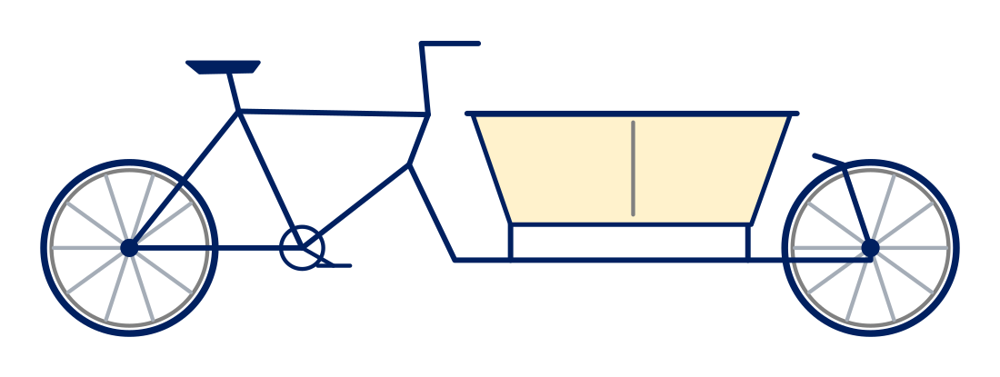

# Introduction to ontologies

## What are ontologies, and why use them?

Making the meaning of research data explicit can help researchers describe, publish, find, integrate and reuse it. This includes recording domain knowledge independently of individual applications: what the data represents and how the things it describes relate to each other. 

In this training, we use the following definition: “*An ontology is a formal, explicit specification of a shared conceptualisation*”. {cite}`studer1998knowledge`

A conceptualisation is a model of the things and relationships relevant to a domain, or area of interest. Shared means agreed by a community. The terms and assumptions are stated explicitly, in a formal language that applications can interpret.

When researchers describe their data with an ontology, others can inspect the model's assumptions and assess whether the data fits their own work. Shared definitions also let researchers interpret data consistently across projects. This supports standardisation and interoperability, the “I” in [FAIR](https://www.gofair.foundation/fair-principles): Findable, Accessible, Interoperable and Reusable data. {cite}`wilkinson2016fair`

Models from different fields can be connected where their concepts overlap. These links help researchers investigate questions that span multiple disciplines. {cite}`bernerslee2004connectingsciences`

## Ontologies and related approaches

These approaches serve different purposes. 

| Approach | What it provides |
|---|---|
| Glossary | Explanations of the meanings of terms |
| Data dictionary | Descriptions of dataset fields, including their meanings, data types and permitted values |
| Controlled vocabulary | Agreed terms or concepts for consistent description and indexing |
| Taxonomy | Concepts organised in a hierarchy of broader and narrower categories |
| Thesaurus | Hierarchical and associative relationships between concepts, with preferred and alternative labels |
| Ontology | Classes (kinds of things), properties (attributes and relationships), and formal statements describing them |

These approaches are not mutually exclusive. For example, taxonomies and thesauri are forms of controlled vocabulary. {cite}`isaac2009skosprimer` And an ontology typically organises its classes in a taxonomic hierarchy. {cite}`noy2001ontology,w3c2012owl2primer`

Choose the level of modelling that serves your research: a data dictionary or controlled vocabulary may be enough. An ontology is useful when you need a shared model of the things your data describes, their relationships and the logical statements that support interpretation or inference. Weigh these benefits against the work needed to agree, document and maintain the model. {cite}`noy2001ontology,w3c2017dwbp`

## Why OWL?

Ontologies can be represented in different ways. This training focuses on OWL 2 (Web Ontology Language), an open standard from the World Wide Web Consortium (W3C) for representing ontologies on the Web. Its public specification gives applications a common language with defined meaning, so models can be exchanged. Applications can use an OWL ontology to infer additional facts and check for logical inconsistencies. {cite}`w3c2012owl2primer`

OWL builds on RDF, the Resource Description Framework, which is also an open W3C standard and expresses information as statements about things and their relationships. Every OWL 2 ontology has a standard RDF representation, so the model can be shared and queried with the same technologies as the data. {cite}`w3c2012owl2overview`

(running-example)=
## The bicycle example

We will use a bicycle inventory as a running example throughout the training.

B001 is our fictional blue cargo bicycle, or *bakfiets* in Dutch. It has two wheels, a cargo box and a steel frame (F001). Cargo bicycles are designed to carry loads in addition to the rider, such as passengers or goods.

To answer a question such as “Which bicycles have steel frames?”, we need to record which bicycle has which frame and the frame's material. An ontology can define bicycles, frames and their properties and relationships in a shared model, so different inventories can describe them consistently.

For example, Bicycle and Frame are classes, “has component” is a property, and “Every Bicycle is a Vehicle” is a logical statement. If B001 is recorded as a Bicycle, an application can also infer that it is a Vehicle. {cite}`w3c2012owl2primer`

## Open-world assumption and no unique-name assumption

Research groups often describe different aspects of the same things and choose identifiers independently.

*OWL reasoning* derives conclusions that follow logically from the ontology and its data. It follows the open-world assumption and makes no unique-name assumption. {cite}`w3c2012owl2primer`

### Working with incomplete information

OWL makes the *open-world assumption (OWA)*: a statement can be true even when it has not been recorded or inferred. An inventory might describe F001 without recording its material. That omission does not imply that the frame is not steel; our inventory can supply the missing material. This lets research groups contribute complementary descriptions and extend their knowledge as new findings become available. {cite}`w3c2012owl2primer` [Distributed descriptions in OWL](https://www.w3.org/TR/owl-guide/#StructureOfOntologies)

### Linking different identifiers

OWL makes *no unique-name assumption*: different identifiers may refer to the same thing. Another inventory might identify our bicycle as C17. The identifiers B001 and C17 alone do not establish whether they refer to one bicycle or two. This can be stated explicitly or inferred from other statements. Once both identifiers are known to refer to the same bicycle, an application can use OWL reasoning to combine information recorded under either identifier. Research groups can therefore connect their descriptions while retaining their own identifiers. {cite}`w3c2012owl2primer`

Links to the relevant [W3C standards and guides](../references.md) are collected on the References page.
