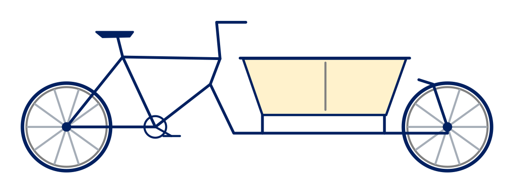

# Introduction to ontologies

## Why ontologies?

Making the meaning of research data explicit can help researchers describe, publish, find, integrate and reuse it. This includes recording domain knowledge independently of individual applications: what the data represents and how the things it describes relate to each other. 

In this training, we use the following definition: an ontology is a formal, explicit specification of a shared conceptualization. {cite}`studer1998knowledge`

A conceptualization is a model of the things and relationships relevant to a domain, or area of interest. Shared means agreed by a community. The terms and assumptions are stated explicitly, in a formal language that applications can interpret.

Researchers can use an ontology to describe their data, helping others inspect the model's assumptions and assess whether the data fits their own work. Shared definitions help researchers interpret data consistently across projects, supporting standardisation and interoperability. Interoperability is the “I” in [FAIR](https://www.gofair.foundation/fair-principles): Findable, Accessible, Interoperable and Reusable data.

Models from different fields can be connected where their concepts overlap. These links help researchers investigate questions that span disciplines. {cite}`bernerslee2004connectingsciences`

## Why OWL?

OWL, the Web Ontology Language, is an open W3C standard. This training uses OWL 2. Its public specification gives compatible tools a common language with defined meaning, so models can be exchanged across applications.

OWL builds on RDF, the Resource Description Framework, which expresses information as statements about things and their relationships. OWL ontologies can themselves be represented as RDF, so the model can be shared and queried with the same technologies as the data. {cite}`w3c2012owl2overview`

Applications can use an OWL ontology to infer additional facts and check for logical inconsistencies. {cite}`w3c2012owl2primer`

(running-example)=
## The bicycle example

We will use a bicycle inventory throughout the training.

B001 is our fictional blue cargo bicycle, or *bakfiets*. It has two wheels, a cargo box and a steel frame, identified as F001. Cargo bicycles are designed to carry loads in addition to the rider, such as shopping, passengers or pets.

Which bicycles have steel frames?

To answer this, we need to connect each bicycle to its frame and record the frame's material. The cargo box may be made of a different material.

Links to the relevant [W3C standards and guides](../references.md) are collected on the References page.
