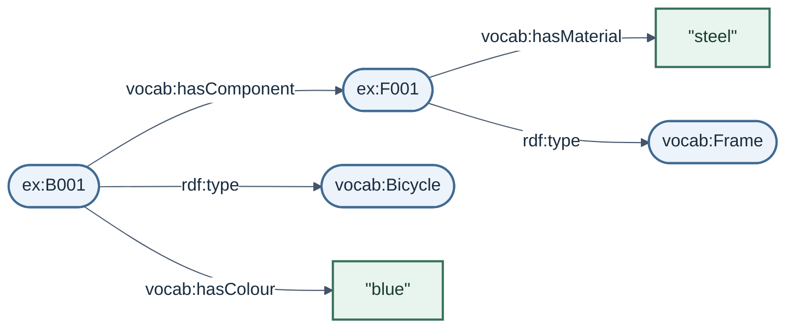

(linked-data-foundations)=
# Linked Data Foundations

We can express the {ref}`bicycle inventory <running-example>` as statements that applications can share and process.

## From descriptions to statements

Consider the sentence “B001 has component F001”. It describes a relationship between the bicycle and its frame.

RDF, the Resource Description Framework, provides a common data model for expressing statements about things, called *resources*. Resources can be physical objects, people, documents or concepts.

Each statement has a *subject* (the thing being described), a *predicate* (the property or relationship) and an *object* (what the subject is related to, or a value). These three parts form a *triple*. [RDF Concepts](https://www.w3.org/TR/rdf11-concepts/#section-triples)

In ordinary words, three of our statements are:

| Subject | Predicate | Object |
|---|---|---|
| B001 | has component | F001 |
| B001 | has colour | “blue” |
| F001 | has material | “steel” |

## Identifiers and values

### Giving things names

B001 is an inventory identifier. Another inventory could use B001 for a different bicycle. An *IRI*, or Internationalized Resource Identifier, gives us a name that can be used across applications and datasets.

For this example, we give the bicycle the IRI `https://example.org/bikes/B001` and its frame `https://example.org/bikes/F001`. These are illustrative identifiers.

Properties have IRIs too. We use `https://example.org/bike-vocab#hasComponent` for the relationship between a bicycle and one of its components. [RDF IRIs](https://www.w3.org/TR/rdf11-concepts/#section-IRIs)

### Recording values and types

An object can be a *literal* representing a value, such as the text “blue” or “steel”, a number or a date. A *datatype* indicates how a value is interpreted: for example, the bicycle's wheel count, 2, is an integer. [RDF literals](https://www.w3.org/TR/rdf11-concepts/#section-Graph-Literal)

We can also state that B001 is a bicycle and F001 is a frame. RDF uses the property `rdf:type` to record these classifications. Bicycle and Frame are *classes*, or kinds of things, and have their own IRIs. [RDF types](https://www.w3.org/TR/rdf-schema/#ch_type)

To keep the diagram and code readable, we shorten IRIs with *prefixes*. For example, `ex:B001` expands to `https://example.org/bikes/B001`.

| Prefix | Beginning of the full IRI |
|---|---|
| `ex:` | `https://example.org/bikes/` |
| `vocab:` | `https://example.org/bike-vocab#` |
| `rdf:` | `http://www.w3.org/1999/02/22-rdf-syntax-ns#` |

Thus `vocab:Bicycle` names the class Bicycle, while `ex:B001` names our particular bicycle.

## The RDF graph

A set of RDF triples forms an *RDF graph*. We can draw subjects and objects as nodes, with arrows labelled by their predicates. When an IRI appears in several triples, the statements meet at the same node.

The diagram combines our three statements with the two type statements. Rounded nodes stand for IRIs; rectangular nodes contain literal values.



To answer “Which bicycles have steel frames?”, start at `ex:B001`, follow `vocab:hasComponent` to `ex:F001`, then follow `vocab:hasMaterial` to “steel”. The type statements tell us that B001 is a bicycle and F001 is a frame.

Try reading the path for B001's colour. Which statement would change if the bicycle were repainted?

```{dropdown} Answer
The path is `ex:B001` → `vocab:hasColour` → “blue”. To record a new colour, change the value in that statement.
```

## Writing the same graph

An application can read the graph from a text file. *Turtle* is one syntax for writing RDF. The following code contains exactly the five statements in the diagram. [RDF Turtle](https://www.w3.org/TR/turtle/#simple-triples)

```turtle
@prefix ex: <https://example.org/bikes/> .
@prefix vocab: <https://example.org/bike-vocab#> .
@prefix rdf: <http://www.w3.org/1999/02/22-rdf-syntax-ns#> .

ex:B001 vocab:hasComponent ex:F001 .
ex:B001 vocab:hasColour "blue" .
ex:F001 vocab:hasMaterial "steel" .
ex:B001 rdf:type vocab:Bicycle .
ex:F001 rdf:type vocab:Frame .
```

The `@prefix` lines declare the abbreviations. Each subsequent line writes a subject, predicate and object, ending with a full stop. Quotation marks mark the text literals.

The order of the triples and the positions of the nodes can change without changing the graph.

## Knowledge graphs

A *knowledge graph* represents knowledge about entities and their relationships using a graph-based data model. Researchers use such graphs to organise descriptions and connect information from different sources. This training uses RDF for its knowledge graphs; other graph models are also used. [Hogan et al., *Knowledge Graphs*](https://www.aidanhogan.com/docs/knowledge-graphs-computing-surveys.pdf)

Our RDF graph records facts about B001 and F001. An ontology defines terms such as Bicycle, Frame and has component; RDF can represent both that ontology and the data using it.

## Linked Data

*Linked Data* connects data through Web identifiers that people and applications can look up to retrieve useful descriptions and follow links to other resources. [Linked Data principles](https://www.w3.org/DesignIssues/LinkedData.html)

Imagine publishing the bicycle inventory this way:

1. Looking up the bicycle's HTTPS IRI returns a description of B001, including its link to F001.
2. Following the frame's IRI retrieves its description, including its material.
3. Another researcher can refer to those same identifiers when adding information about the bicycle or frame.

Looking up a bicycle or frame identifier retrieves a document describing it. Both descriptions could be served in the same document. [Cool URIs for the Semantic Web](https://www.w3.org/TR/cooluris/#distinguishing)

A Turtle file stored on a researcher's computer already contains RDF. Publishing it as Linked Data also involves arranging these lookups and links. The illustrative `example.org` identifiers used here have no lookup service.

Linked Data can be access-controlled. *Linked Open Data* adds open access and an open licence; the access and reuse conditions should be stated explicitly.

## How Linked Data can support FAIR

The FAIR principles concern how people and applications can find, access, interpret and reuse data and its descriptions (*metadata*). They allow different technical approaches. RDF and Linked Data can support their implementation, with further work on the dataset's publication and maintenance. [FAIR principles](https://www.gofair.foundation/fair-principles)

| FAIR aspect | Contribution from RDF and Linked Data | What researchers still arrange |
|---|---|---|
| Findable | Identifiers and structured descriptions help applications identify resources. | Persistent identifiers, rich dataset metadata and registration in a searchable catalogue or repository. |
| Accessible | Web identifiers can lead to descriptions through standard protocols. | Reliable access, clear access conditions and metadata that remain available if the data disappears. |
| Interoperable | A common data model, shared vocabulary terms and explicit relationships help connect descriptions. | Suitable vocabularies that are themselves FAIR, with meaningful links between resources. |
| Reusable | Descriptions and links provide context for assessing data. | Clear usage licences, provenance describing how the data was produced, and sufficient detail to meet relevant community standards. |

The bicycle and frame identifiers name objects in the inventory. The dataset itself also needs an identifier and metadata describing it.

```{note}
These publication and maintenance tasks take time and resources. Researchers can weigh that effort against the benefits for their project.
```
