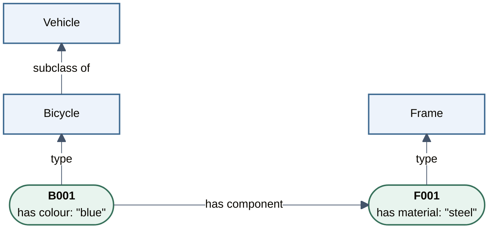

(linked-data-foundations)=
# Linked Data Foundations

## What is Linked Data?

*Linked Data* is an approach to publishing structured data on the Web so that people and applications can find related information by following links.

The approach follows four [Linked Data principles](https://www.w3.org/DesignIssues/LinkedData.html):

1. Use Web identifiers to name things.
2. Use HTTP or HTTPS identifiers that people and applications can look up.
3. When an identifier is looked up, provide useful descriptions using the Resource Description Framework (RDF).
4. Include links to other identifiers, so related information can be discovered.

Linked Data can be access-controlled. *Linked Open Data* is openly accessible under an open licence.

## RDF: the data model for Linked Data

Linked Data uses RDF, a W3C standard data model, to express descriptions and links as statements about *resources*: people, objects, documents or concepts. Each *triple* has a *subject* (what is described), a *predicate* (the property or relationship) and an *object* (what it relates to, or a value). [RDF Primer](https://www.w3.org/TR/rdf11-primer/)

In the {ref}`bicycle inventory <running-example>`, B001 is the bicycle and F001 its frame:

| Subject | Predicate | Object |
|---|---|---|
| B001 | has component | F001 |
| B001 | has colour | “blue” |
| F001 | has material | “steel” |

RDF uses *IRIs* (Internationalized Resource Identifiers) as names across datasets. Since another inventory could also have a B001, we use `https://example.org/bikes/B001` for our bicycle and `https://example.org/bikes/F001` for its frame. Properties and classes have IRIs too. We use `example.org` as a placeholder domain. [RDF IRIs](https://www.w3.org/TR/rdf11-concepts/#section-IRIs)

## Connecting statements into a graph

An *RDF graph* is a set of triples. In this compact view, boxes are *nodes* connected by labelled arrows. Repeated subject or object IRIs connect statements at the same node.



Inside B001's box, “blue” is a text *literal*: a value in the object position of a triple. A literal's *datatype* tells applications how to interpret its written value, for example as text, a number or a date. [RDF literals](https://www.w3.org/TR/rdf11-concepts/#section-Graph-Literal)

Bicycle is a *class* representing a kind of thing, shown in a square box. B001 is a particular bicycle, an *instance* of that class, shown in a rounded box. The *type* arrow from B001 to Bicycle records this membership. [RDF types](https://www.w3.org/TR/rdf-schema/#ch_type)

RDF Schema (RDFS) provides the *subclass of* relationship between classes. Every instance of Bicycle is also an instance of Vehicle, so B001 also belongs to Vehicle. [RDF subclasses](https://www.w3.org/TR/rdf-schema/#ch_subclassof)

The *ontology layer* defines the classes, properties and class relationships used here. The *instance data layer* records facts about B001 and F001.

## Knowledge graphs and ontologies

A *knowledge graph* represents things and their relationships in a graph data model. [Hogan et al., *Knowledge Graphs*](https://www.aidanhogan.com/docs/knowledge-graphs-computing-surveys.pdf) This course covers only knowledge graphs that use RDF and follow Linked Data principles.

RDF supports a *data-centric approach*: data and their domain definitions can be shared independently of individual applications. Researchers gain flexibility to use the same data and ontology in new applications as their questions develop. Reusing these definitions can improve efficiency by reducing repeated work to encode and maintain the same domain knowledge in each application. [Data-Centric Manifesto](https://datacentricmanifesto.org/), [Domain model reuse](https://www.w3.org/TR/sw-oosd-primer/)

## Writing the graph in Turtle

*Turtle* is one syntax for writing RDF as text. *Prefixes* abbreviate IRIs: `ex:B001` expands to `https://example.org/bikes/B001`. Here, `ex:` abbreviates inventory IRIs; `rdfs:` refers to RDF Schema terms; `vocab:` abbreviates class and property IRIs. [RDF Turtle](https://www.w3.org/TR/turtle/#simple-triples)

```turtle
@prefix ex: <https://example.org/bikes/> .
@prefix rdfs: <http://www.w3.org/2000/01/rdf-schema#> .
@prefix vocab: <https://example.org/bike-vocab#> .

ex:B001 a vocab:Bicycle ;
    vocab:hasComponent ex:F001 ;
    vocab:hasColour "blue" .

ex:F001 a vocab:Frame ;
    vocab:hasMaterial "steel" .

vocab:Bicycle rdfs:subClassOf vocab:Vehicle .
```

As a predicate, `a` is Turtle shorthand for `rdf:type`, labelled *type* in the diagram. A semicolon continues statements about the same subject; a full stop ends the block. Triple order does not change the graph.

In Turtle, `2` represents an integer that applications can use in calculations; `"2"` represents a text string.

## Publishing Linked Data

A local Turtle file already expresses RDF. To publish the inventory as Linked Data, provide RDF descriptions when people or applications look up its identifiers. B001's description could link to F001; following that link would retrieve the frame's description and its material. Links can also lead to resources described in other datasets. [Cool URIs](https://www.w3.org/TR/cooluris/#distinguishing)

## How Linked Data can support FAIR

The [FAIR principles](https://www.gofair.foundation/fair-principles) aim to make research data and their descriptions (*metadata*) Findable, Accessible, Interoperable and Reusable.

| FAIR goal | How Linked Data contributes |
|---|---|
| Findable | Identifiers and structured metadata help people and applications discover datasets. |
| Accessible | Looking up Web identifiers retrieves descriptions through HTTP(S). |
| Interoperable | RDF, shared terms and explicit relationships help applications combine and interpret data. |
| Reusable | Linked descriptions can record how data were produced and the conditions for reuse. |

Putting FAIR into practice includes persistent identifiers, searchable metadata, clear access conditions and a reuse licence.
