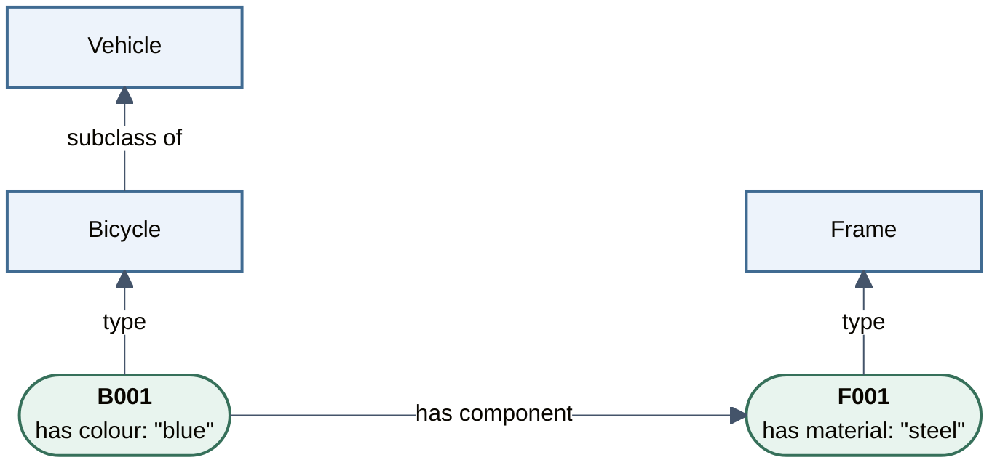

(linked-data-foundations)=
# Linked Data Foundations

:::{admonition} Learning objectives
:class: note

By the end of this chapter, you will be able to:

- Explain how Linked Data connects research data across datasets and applications.
- Identify the subject, predicate and object of an RDF statement and explain what it records.
- Interpret a simple Turtle example by expanding prefixed names to full IRIs and identifying literal values.
- Explain which statements a basic SPARQL query matches and why it returns its result.
- Explain the requirement expressed by a simple SHACL shape and whether an example graph meets it.
- Describe what is needed to publish RDF as Linked Data.
- Explain how Linked Data can support FAIR research data.
:::

## What is Linked Data?

*Linked Data* is an approach to publishing structured data on the Web so that people and applications can find related information by following links.

The approach follows four [Linked Data principles](https://www.w3.org/DesignIssues/LinkedData.html):

1. Use Web identifiers to name things.
2. Use HTTP or HTTPS identifiers that people and applications can look up.
3. When an identifier is looked up, provide useful descriptions using the Resource Description Framework (RDF).
4. Include links to other identifiers, so related information can be discovered.

Linked Data can be access-controlled. *Linked Open Data* is openly accessible under an open licence.

## RDF: the data model for Linked Data

Linked Data uses RDF, a W3C standard data model, to express descriptions and links as statements about *resources*: people, objects, documents or concepts. Each statement is a *triple* with a *subject* (what is described), a *predicate* (the property or relationship) and an *object* (what it relates to, or a value). [RDF Primer](https://www.w3.org/TR/rdf11-primer/)

In the {ref}`bicycle inventory <running-example>`, B001 is the bicycle and F001 its frame:

| Subject | Predicate | Object |
|---|---|---|
| B001 | has component | F001 |
| B001 | has colour | “blue” |
| F001 | has material | “steel” |

RDF uses *IRIs* (Internationalized Resource Identifiers) as names across datasets. The same IRI identifies the same resource wherever it appears, including across datasets. Since another inventory could also have a B001, we use `https://w3id.org/bicycle-ontology/id/B001` for our bicycle and `https://w3id.org/bicycle-ontology/id/F001` for its frame. Properties and classes have IRIs too. [RDF IRIs](https://www.w3.org/TR/rdf11-concepts/#section-IRIs)

## From statements to knowledge graphs

A *knowledge graph* represents things and their relationships in a graph data model. [Hogan et al., *Knowledge Graphs*](https://www.aidanhogan.com/docs/knowledge-graphs-computing-surveys.pdf) This course covers only knowledge graphs that use RDF and follow Linked Data principles.

An *RDF graph* is a set of triples. The diagram adds three statements to those in the table: B001 is a Bicycle, F001 is a Frame, and every Bicycle is a Vehicle. In this compact view, boxes labelled with short resource names are *nodes* connected by labelled arrows. Repeated subject or object IRIs connect statements at the same node.

<div role="img" aria-label="B001 has component F001 and has colour blue. F001 has material steel. B001 has type Bicycle and F001 has type Frame. Bicycle is a subclass of Vehicle.">



</div>

Inside B001's box, “blue” is a text *literal*: a value in the object position of a triple. A literal's *datatype* tells applications how to interpret its written value, for example as text, a number or a date. [RDF literals](https://www.w3.org/TR/rdf11-concepts/#section-Graph-Literal)

Bicycle is a *class* representing a kind of thing, shown in a square box. B001 is a particular bicycle, an *instance* of that class, shown in a rounded box. The *type* arrow from B001 to Bicycle records this membership. [RDF types](https://www.w3.org/TR/rdf-schema/#ch_type)

RDF Schema (RDFS) provides the *subclass of* relationship between classes. Every instance of Bicycle is also an instance of Vehicle, so B001 also belongs to Vehicle. [RDF subclasses](https://www.w3.org/TR/rdf-schema/#ch_subclassof)

An ontology defines classes such as Bicycle and properties such as “has component”, and states that Bicycle is a subclass of Vehicle. The *instance data* uses the IRIs of these terms to describe B001 and F001. RDF can express both the ontology and the instance data. [Ontology terms in RDF](https://www.w3.org/TR/rdf11-primer/#section-vocabulary)

RDF is *flexible*: researchers can extend a graph with new properties and relationships as research needs develop. [RDF data model](https://www.w3.org/RDF/)

Using the same IRI for the same resource connects descriptions across datasets, even when their structures differ. For example, one dataset can link B001 to F001 while another records F001's material. When the graphs are combined, the shared IRI `https://w3id.org/bicycle-ontology/id/F001` connects these statements at the same node. [Combining RDF graphs](https://www.w3.org/TR/rdf11-concepts/#section-multigraph)

`http://w3id.org/bicycle-ontology/id/F001` and `https://w3id.org/bicycle-ontology/id/F001` are different IRIs. A browser may follow a redirect between them. Queries match IRIs exactly, so using one can miss data recorded with the other. [IRI comparison](https://www.w3.org/TR/rdf11-concepts/#section-IRIs), [SPARQL matching](https://www.w3.org/TR/sparql11-query/#BasicGraphPatternMatching)

## The data-centric approach

An inventory application and an analysis application can reuse the same bicycle data and the statement that Bicycle is a subclass of Vehicle. This is a *data-centric approach*: recording domain knowledge in shared data and ontologies so applications can use the same definitions. Managing the data and definitions separately from application code can reduce repeated work to prepare data and maintain its definitions. [Data-Centric Manifesto](https://datacentricmanifesto.org/principles/), [Sharing data and domain models](https://www.w3.org/TR/sw-oosd-primer/)

## Serialisation: Turtle and other formats

*Serialisation* represents an RDF graph in a format for storage or exchange. Turtle, JSON-LD, RDF/XML and N-Triples are RDF serialisation formats: they can represent the same graph using different syntax. [RDF serialisation formats](https://www.w3.org/TR/rdf11-primer/#section-syntax)

We use *Turtle* for the course examples because its compact syntax makes RDF statements easier to read, edit and check. RDF/XML is an alternative when an application or publishing workflow requires it. [Turtle specification](https://www.w3.org/TR/turtle/)

For the bicycle graph, *prefixes* abbreviate IRIs: `id:B001` expands to `https://w3id.org/bicycle-ontology/id/B001`. Here, `def:` abbreviates class and property IRIs, `id:` individual IRIs and `rdfs:` RDF Schema terms, so `def:Bicycle` expands to `https://w3id.org/bicycle-ontology/def/Bicycle`. [RDF Turtle](https://www.w3.org/TR/turtle/#simple-triples)

The `@prefix` declarations below define these abbreviations; the remaining lines express the graph's six statements.

As a predicate, `a` is Turtle shorthand for the *type* relationship shown in the diagram (the RDF property `rdf:type`). A semicolon continues statements about the same subject; a full stop ends the block. Triple order does not change the graph.

The colour and material names use `@en` to identify their language as English.

```turtle
@prefix def: <https://w3id.org/bicycle-ontology/def/> .
@prefix id: <https://w3id.org/bicycle-ontology/id/> .
@prefix rdfs: <http://www.w3.org/2000/01/rdf-schema#> .

id:B001 a def:Bicycle ;
    def:hasComponent id:F001 ;
    def:hasColour "blue"@en .

id:F001 a def:Frame ;
    def:hasMaterial "steel"@en .

def:Bicycle rdfs:subClassOf def:Vehicle .
```

If we recorded that B001 has two wheels, `2` would represent an integer that applications can use in calculations, while `"2"` would represent a text string.

(sparql-basics)=
## Query RDF with SPARQL

*SPARQL* is a query language for RDF, whether loaded locally or made available through a service. A query describes a pattern of statements to match and specifies what information to return. The following query searches the bicycle graph above for bicycles with frames recorded as steel. It needs no reasoning.

`PREFIX` defines the same IRI abbreviation as `@prefix` in Turtle. Names beginning with `?` are variables whose values will be found by matching the patterns:

```sparql
PREFIX def: <https://w3id.org/bicycle-ontology/def/>

SELECT DISTINCT ?bicycle
WHERE {
    ?bicycle a def:Bicycle ;
        def:hasComponent ?frame .
    ?frame a def:Frame ;
        def:hasMaterial "steel"@en .
}
```

The patterns inside `WHERE` use the familiar Turtle forms `a` and `;`. The same `?frame` in both patterns connects each bicycle to its frame's material. `SELECT` chooses the variable to return, and `DISTINCT` returns each matching bicycle once, even if several frames match. The result is `https://w3id.org/bicycle-ontology/id/B001`; the query interface may display an abbreviated name. [SPARQL basic queries](https://www.w3.org/TR/sparql11-query/#WritingSimpleQueries)

The material pattern matches the language-tagged value `"steel"@en`. `"Steel"@en`, `"steel"@nl` and the untagged string `"steel"` are different RDF terms. Consistent source-data preparation and conversion make these matches reliable.

(shacl-basics)=
## Validate RDF with SHACL

*SHACL* (Shapes Constraint Language) is a W3C standard for validating RDF graphs against chosen requirements, expressed as *shapes*. Shapes are themselves RDF. A validator takes the graph to check (the *data graph*) and a *shapes graph*, and produces a validation report. [SHACL specification](https://www.w3.org/TR/shacl/)

For an inventory review that needs recorded materials, we can require each Frame to have at least one `hasMaterial` value. This *property shape* expresses that requirement. The `sh:` prefix names SHACL terms; `shape:` names our example shape:

```turtle
@prefix def: <https://w3id.org/bicycle-ontology/def/> .
@prefix sh: <http://www.w3.org/ns/shacl#> .
@prefix shape: <https://w3id.org/bicycle-ontology/shape/> .

shape:FrameMaterial a sh:PropertyShape ;
    sh:targetClass def:Frame ;
    sh:path def:hasMaterial ;
    sh:minCount 1 .
```

`sh:targetClass` selects Frame instances, `sh:path` names the property to check and `sh:minCount 1` requires at least one recorded value. [Property shapes](https://www.w3.org/TR/shacl/#property-shapes), [minimum count](https://www.w3.org/TR/shacl/#MinCountConstraintComponent)

The bicycle graph above conforms: F001 has a recorded material. If its material statement were removed, the report would identify F001 and `hasMaterial` as failing the minimum-count requirement.

The data graph can also be an ontology: a shape could check that its classes have labels. SHACL can therefore check chosen requirements for both ontology descriptions and instance data. [Data graphs](https://www.w3.org/TR/shacl/#data-graph)

## Publishing Linked Data

Our Turtle file already expresses RDF. Publishing the graph as Linked Data also involves making its resource IRIs *dereferenceable*: looking one up retrieves a description of what it identifies. A Web page (a *landing page*) provides a readable description for people; RDF provides it for applications. The description of B001 can link to F001, whose description gives the frame's material; links can also lead to other datasets. [Cool URIs](https://www.w3.org/TR/cooluris/#semweb)

Class and property IRIs work the same way: `def:Bicycle` can lead to its label and relationship to Vehicle. New terms need published descriptions. Existing terms retain their exact IRIs, including `http:` in the `rdfs:` namespace, so the data continues to identify those terms. [Publishing vocabularies and ontologies](https://www.w3.org/TR/swbp-vocab-pub/#requirements)

*Persistent identifiers (PIDs)* are managed to remain usable when descriptions move to another Web address. {cite}`w3c2017dwbp` For example, [w3id](https://w3id.org/) provides stable IRIs under `https://w3id.org/` that redirect to your published descriptions. When the descriptions move, changing the redirect destinations keeps the IRIs usable.

For new IRIs, HTTPS supports secure access, which depends on maintaining a valid certificate for the publishing domain. [HTTPS requirements](https://www.rfc-editor.org/rfc/rfc9110.html#section-4.3.3)

(triple-stores)=
:::{dropdown} Triple stores and SPARQL endpoints (optional)

The Web server can supply RDF descriptions from static files, such as downloadable Turtle files, or retrieve them from a *triple store*, a database for storing and querying RDF. Researchers can use its query interface; applications can send SPARQL queries over HTTP to its *SPARQL endpoint*. {cite}`w3c2014linkeddata`

Options include [QLever](https://docs.qlever.dev/quickstart/), [Apache Jena Fuseki with TDB](https://jena.apache.org/documentation/fuseki2/fuseki-quick-start.html) and [Eclipse RDF4J Server and Workbench](https://rdf4j.org/documentation/tools/server-workbench/). Follow the chosen application's setup and loading instructions: QLever builds an index from RDF files; Fuseki also offers file uploads.

:::

## How Linked Data can support FAIR

The [FAIR principles](https://www.gofair.foundation/fair-principles) aim to make research data and their descriptions (*metadata*) Findable, Accessible, Interoperable and Reusable. {cite}`wilkinson2016fair`

| FAIR goal | How Linked Data contributes |
|---|---|
| Findable | Identifiers and structured metadata help people and applications discover datasets. |
| Accessible | Looking up Web identifiers retrieves descriptions through HTTP(S). |
| Interoperable | RDF, shared terms and explicit relationships help applications combine and interpret data. |
| Reusable | Linked descriptions can record how data were produced and the conditions for reuse. |

FAIR also involves searchable metadata, clear access conditions and a reuse licence.
