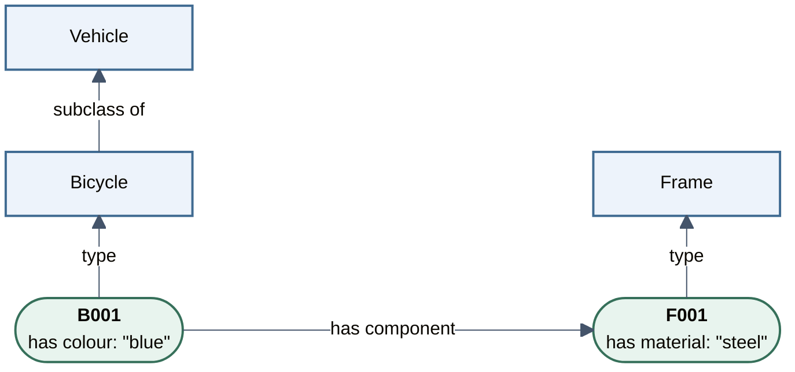

(linked-data-foundations)=
# Linked Data Foundations

## What is Linked Data?

*Linked Data* is an approach to publishing structured data on the Web so that people and applications can find related information by following links.

The approach follows four [Linked Data principles](https://www.w3.org/DesignIssues/LinkedData.html):

1. Use Web identifiers to name things.
2. Use HTTP or HTTPS identifiers that people and applications can look up.
3. When an identifier is looked up, provide useful descriptions using the Resource Description Framework (RDF).
4. Include links to other identifiers, so related information can be discovered.

Linked Data can be access-controlled. *Linked Open Data* is openly accessible under an open licence.

## RDF: the data model for Linked Data

Linked Data uses RDF, a W3C standard data model, to express descriptions and links as statements about *resources*: people, objects, documents or concepts. Each statement is a *triple* with a *subject* (what is described), a *predicate* (the property or relationship) and an *object* (what it relates to, or a value). [RDF Primer](https://www.w3.org/TR/rdf11-primer/)

In the {ref}`bicycle inventory <running-example>`, B001 is the bicycle and F001 its frame:

| Subject | Predicate | Object |
|---|---|---|
| B001 | has component | F001 |
| B001 | has colour | “blue” |
| F001 | has material | “steel” |

RDF uses *IRIs* (Internationalized Resource Identifiers) as names across datasets. Since another inventory could also have a B001, we use `https://example.org/bikes/B001` for our bicycle and `https://example.org/bikes/F001` for its frame. Properties and classes have IRIs too. We use `example.org` as a placeholder domain. [RDF IRIs](https://www.w3.org/TR/rdf11-concepts/#section-IRIs)

## Connecting statements into a graph

An *RDF graph* is a set of triples. The diagram adds three statements to those in the table: B001 is a Bicycle, F001 is a Frame, and every Bicycle is a Vehicle. In this compact view, boxes labelled with short resource names are *nodes* connected by labelled arrows. Repeated subject or object IRIs connect statements at the same node.



Inside B001's box, “blue” is a text *literal*: a value in the object position of a triple. A literal's *datatype* tells applications how to interpret its written value, for example as text, a number or a date. [RDF literals](https://www.w3.org/TR/rdf11-concepts/#section-Graph-Literal)

Bicycle is a *class* representing a kind of thing, shown in a square box. B001 is a particular bicycle, an *instance* of that class, shown in a rounded box. The *type* arrow from B001 to Bicycle records this membership. [RDF types](https://www.w3.org/TR/rdf-schema/#ch_type)

RDF Schema (RDFS) provides the *subclass of* relationship between classes. Every instance of Bicycle is also an instance of Vehicle, so B001 also belongs to Vehicle. [RDF subclasses](https://www.w3.org/TR/rdf-schema/#ch_subclassof)

An ontology defines classes such as Bicycle and properties such as “has component”, and states that Bicycle is a subclass of Vehicle. The *instance data* uses the IRIs of these terms to describe B001 and F001. RDF can express both the ontology and the instance data. [Ontology terms in RDF](https://www.w3.org/TR/rdf11-primer/#section-vocabulary)

## Knowledge graphs and the data-centric approach

A *knowledge graph* represents things and their relationships in a graph data model. [Hogan et al., *Knowledge Graphs*](https://www.aidanhogan.com/docs/knowledge-graphs-computing-surveys.pdf) This course covers only knowledge graphs that use RDF and follow Linked Data principles.

RDF is *flexible*: researchers can extend a graph with new properties and relationships as research needs develop. [RDF data model](https://www.w3.org/RDF/)

Using the same IRI for the same resource connects descriptions across datasets, even when their structures differ. For example, one dataset can link B001 to F001 while another records F001's material. When the graphs are combined, the shared IRI `https://example.org/bikes/F001` connects these statements at the same node. [Combining RDF graphs](https://www.w3.org/TR/rdf11-concepts/#section-multigraph)

`http://example.org/bikes/F001` and `https://example.org/bikes/F001` are different IRIs. A browser may follow a redirect between them. SPARQL, the query language for RDF, matches IRIs exactly, so a query using one can miss data recorded with the other. [IRI comparison](https://www.w3.org/TR/rdf11-concepts/#section-IRIs), [SPARQL matching](https://www.w3.org/TR/sparql11-query/#BasicGraphPatternMatching)

In a *data-centric approach*, domain knowledge is represented explicitly in shared data and ontologies, rather than encoded separately in each application's code. An inventory application and an analysis application can reuse the same bicycle data and the statement that Bicycle is a subclass of Vehicle. Managing data and definitions independently of individual applications can reduce repeated work to prepare data and maintain its definitions. [Data-Centric Manifesto](https://datacentricmanifesto.org/principles/), [Sharing data and domain models](https://www.w3.org/TR/sw-oosd-primer/)

## RDF serialisation: Turtle and other formats

*Serialisation* represents an RDF graph in a format for storage or exchange. Turtle, JSON-LD, RDF/XML and N-Triples are RDF serialisation formats: they can represent the same graph using different syntax. [RDF serialisation formats](https://www.w3.org/TR/rdf11-primer/#section-syntax)

We write the bicycle graph in *Turtle*, a compact format for reading and writing RDF by hand. *Prefixes* abbreviate IRIs: `ex:B001` expands to `https://example.org/bikes/B001`. Here, `ex:` abbreviates inventory IRIs, `rdfs:` RDF Schema terms and `vocab:` class and property IRIs, so `vocab:Bicycle` expands to `https://example.org/bike-vocab#Bicycle`. [RDF Turtle](https://www.w3.org/TR/turtle/#simple-triples)

The `@prefix` declarations below define these abbreviations; the remaining lines express the graph's six statements.

As a predicate, `a` is Turtle shorthand for the *type* relationship shown in the diagram (the RDF property `rdf:type`). A semicolon continues statements about the same subject; a full stop ends the block. Triple order does not change the graph.

```turtle
@prefix ex: <https://example.org/bikes/> .
@prefix rdfs: <http://www.w3.org/2000/01/rdf-schema#> .
@prefix vocab: <https://example.org/bike-vocab#> .

ex:B001 a vocab:Bicycle ;
    vocab:hasComponent ex:F001 ;
    vocab:hasColour "blue" .

ex:F001 a vocab:Frame ;
    vocab:hasMaterial "steel" .

vocab:Bicycle rdfs:subClassOf vocab:Vehicle .
```

If we recorded that B001 has two wheels, `2` would represent an integer that applications can use in calculations, while `"2"` would represent a text string.

## Publishing Linked Data

A local Turtle file already expresses RDF. Ideally, published IRIs are *dereferenceable*: looking one up retrieves a description of what it identifies. A *landing page* presents this as a Web page for people; applications can retrieve the description as RDF. For B001, it can include the link to F001, whose description gives the frame's material. Links can also lead to other datasets. [Cool URIs](https://www.w3.org/TR/cooluris/#semweb)

Use *persistent identifiers (PIDs)*, managed to remain usable over time even when descriptions move to another Web address. {cite}`w3c2017dwbp`

Prefer HTTPS for new IRIs and maintain a valid TLS certificate for the publishing domain so people and applications can retrieve descriptions securely. [HTTPS requirements](https://www.rfc-editor.org/rfc/rfc9110.html#section-4.3.3)

These practices also apply to vocabularies and ontologies: class and property IRIs can lead to their definitions. For `vocab:Bicycle`, this can include its label and relationship to Vehicle. Reuse suitable published term IRIs exactly as defined, including `http:` where used, as in the `rdfs:` namespace above. Publish descriptions for new terms so research groups can use the same definitions. [Publishing vocabularies and ontologies](https://www.w3.org/TR/swbp-vocab-pub/#requirements)

## How Linked Data can support FAIR

The [FAIR principles](https://www.gofair.foundation/fair-principles) aim to make research data and their descriptions (*metadata*) Findable, Accessible, Interoperable and Reusable. {cite}`wilkinson2016fair`

| FAIR goal | How Linked Data contributes |
|---|---|
| Findable | Identifiers and structured metadata help people and applications discover datasets. |
| Accessible | Looking up Web identifiers retrieves descriptions through HTTP(S). |
| Interoperable | RDF, shared terms and explicit relationships help applications combine and interpret data. |
| Reusable | Linked descriptions can record how data were produced and the conditions for reuse. |

FAIR also involves searchable metadata, clear access conditions and a reuse licence.
