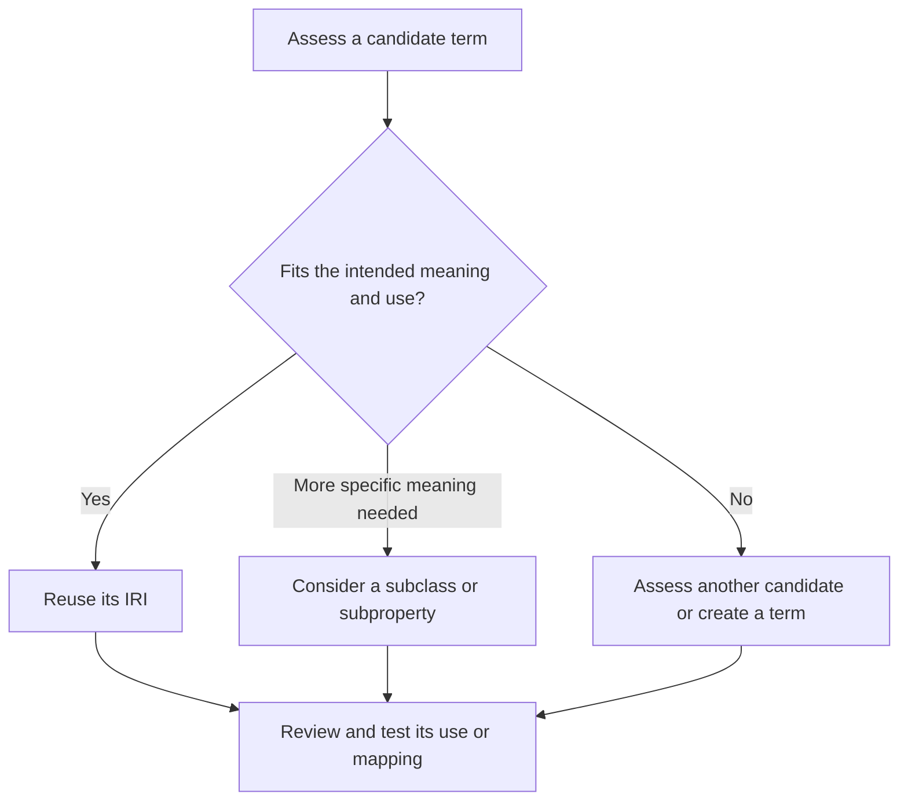

# Reuse ontologies

Reusing existing ontologies and vocabularies, and connecting your ontology to them.

:::{admonition} Learning objectives
:class: note

By the end of this chapter, you will be able to:

- Explain why and when to map an ontology to external ontologies and vocabularies.
- Find suitable ontologies and vocabularies, and suitable terms within them, using standard resources.
- Assess a term's meaning and logical consequences before reusing or mapping it.
- Compare mapping approaches and choose one that fits, including [SHACL-AF rules](https://www.w3.org/TR/shacl-af/#rules) for deriving RDF triples with terms from another ontology.
:::

```{admonition} Under development
:class: warning
This chapter is a draft.
```

## Why reuse?

Reusing terms can help researchers combine descriptions across datasets and use definitions already developed by a community. Mapping connects terms when projects retain their own ontologies. Both require agreement about meaning: a useful match depends on what the research data describes and how it will be used. {cite}`w3c2017dwbp`

## Find and assess existing models

### Where to look

These resources help locate candidate terms:

| Resource | What to look for |
|---|---|
| [W3C standards and specifications](https://www.w3.org/TR/) | Published vocabularies such as DCAT for dataset descriptions, PROV-O for provenance and SKOS for concept schemes; check each document's status |
| Community specifications and de facto standards | Models used by relevant research communities, repositories or collaborators; follow their term IRIs to the publisher's documentation |
| [Linked Open Vocabularies (LOV)](https://lov.linkeddata.es/) | Vocabulary and term records, with links to definitions and publishers |
| [Schema.org](https://schema.org/docs/schemas.html) | Broad terms for describing things such as people, organisations, datasets and products on the Web |

Use catalogue results to find candidates, then consult the vocabulary's own documentation and RDF. For a controlled vocabulary, also look for individual concepts that could supply values, such as a language or material identifier.

### Reuse, extend or build

Before creating a new ontology, check which ontologies your research community uses and which terms the datasets you want to use already refer to. In RDF data, the class and property IRIs can identify those terms. You can reuse suitable terms, extend an existing ontology with missing concepts, or create new terms where existing models do not express the meaning you need. These choices can be combined. {cite}`noy2001ontology`

When assessing an existing ontology, check:

- Whether its definitions, relationships and logical statements fit your intended meaning and level of detail.
- Whether relevant research communities or collaborating projects use it.
- Whether documentation, a licence and information about maintenance and versions are available.

Read the definitions and logical statements behind a promising term: matching labels alone do not establish a match in meaning. {cite}`w3c2017dwbp,w3c2014linkeddata`

For a property, check its direction, domains, ranges and any restrictions or characteristics. A property whose domain is Bicycle would classify all its subjects as bicycles, including a frame if used on F001. Multiple RDFS domains or ranges apply together, as explained in {ref}`chapter 5 <owl-property-axioms>`.

Read vocabulary-specific conventions too. Schema.org uses `domainIncludes` and `rangeIncludes` to describe expected uses; these differ from the RDFS domain and range axioms used in our ontology. [Schema.org data model](https://schema.org/docs/datamodel.html)

The following decisions apply to each needed term, so one ontology can combine several approaches:

<div role="img" aria-label="Assess a candidate term's meaning and use. Reuse its IRI if it fits; extend it if the required meaning is more specific. If it does not fit, assess another candidate or create a new term. Review and test any proposed mapping.">



</div>

Keep a short record of the chosen terms, sources and versions, why they fit and which alternatives were rejected. Revisit existing mappings when either model changes.

## Choose a reuse or mapping approach

### Reuse terms directly

Direct reuse means using an existing term's IRI in your RDF. The ontology header already does this with `dcterms:title` and `dcterms:license`.

For example, [Schema.org's Vehicle](https://schema.org/Vehicle) covers devices designed or used to transport people or cargo. Its [color property](https://schema.org/color) records a product's colour as text. A separate description of B001 could use these terms:

```turtle
@prefix id: <https://w3id.org/bicycle-ontology/id/> .
@prefix schema: <https://schema.org/> .

id:B001 a schema:Vehicle ;
    schema:color "blue"@en .
```

This description can be combined with the bicycle inventory through B001's shared IRI. It supplies a broad type and colour; our frame relationships still provide the detail needed for the frame-material question.

Direct reuse avoids maintaining a local term for the same meaning. It also makes your data depend on the external definition and its maintenance. Preserve the publisher's IRI exactly, including its HTTP or HTTPS scheme.

The same approach applies to values drawn from controlled vocabularies: use a selected concept's IRI as the object of an appropriate relationship. Keep its label for display. Reusing a concept IRI connects records even when their display labels use different languages. [SKOS concepts and labels](https://www.w3.org/TR/skos-primer/#secconcept)

(owl-imports)=
### Import an ontology

An `owl:imports` statement brings another ontology's axioms into reasoning, including those of its imports. Using its term IRIs alone does not import their defining axioms. An import can refer to a particular version using its version IRI. [Ontology imports](https://www.w3.org/TR/owl2-syntax/#Imports)

The supplied example keeps reusable definitions in `bicycle-ontology.ttl` and records in `bicycle-example-data.ttl`. The latter contains:

```turtle
@prefix owl: <http://www.w3.org/2002/07/owl#> .

<https://w3id.org/bicycle-ontology/examples/> a owl:Ontology ;
    owl:imports <https://w3id.org/bicycle-ontology/> .
```

To inspect this import in Protégé:

1. Keep the ontology, sample data and catalog from {doc}`logical-modelling-in-owl` together, following that chapter's file instructions.
2. Open `bicycle-example-data.ttl`. In **Active ontology**, inspect **Imported Ontologies**. The entry should show the ontology IRI and a local source location resolved through `catalog-v001.xml`. A failed import shows only its IRI. [Imported Ontologies view](https://protegeproject.github.io/protege/views/imported-ontologies/)
3. In **Entities > Classes**, inspect Bicycle and its Vehicle superclass. The records file uses these terms; their definitions come from the imported ontology.
4. Start HermiT and query `def:BicycleWithSteelFrame` in **DL Query**, with **Instances** selected. Expect B001 and its alias C17, using the imported steel-frame definition and the sample records.

To add an import to a working ontology, use **+** beside **Direct imports** in **Active ontology**. In the import wizard, choose the local-file option and select the ontology file. Check the ontology IRI and source location before finishing. Protégé adds `owl:imports` to the working ontology and records the local file location in `catalog-v001.xml`. [Import wizard and catalogs](https://protegewiki.stanford.edu/wiki/Importing_Ontologies_in_P41)

An import provides the axioms needed for these inferences, while keeping the files separate. It also adds dependencies: check that imports resolve and that the combined ontology meets the chosen reasoner's requirements. Record the versions you test, and review updates before adopting them.

### Extend with subclasses and subproperties

Extension adds a more specific term while retaining the broader relationship. For example, if our Bicycle class fits Schema.org's Vehicle definition:

```turtle
@prefix def: <https://w3id.org/bicycle-ontology/def/> .
@prefix rdfs: <http://www.w3.org/2000/01/rdf-schema#> .
@prefix schema: <https://schema.org/> .

def:Bicycle rdfs:subClassOf schema:Vehicle .
```

With RDFS inference, B001's Bicycle membership then also establishes its Schema.org Vehicle membership. The reverse does not follow. Likewise, `rdfs:subPropertyOf` is suitable when every use of the local property also expresses the broader external relationship. The {ref}`hasFrame/hasComponent example <owl-property-axioms>` shows this direction.

Extension preserves a useful local distinction. Check the inherited consequences, including external domains and ranges, before adopting it. [Class and property hierarchies](https://www.w3.org/TR/owl2-primer/#Property_Hierarchies)

### Align existing classes and properties

*Alignment* records a relationship between terms in existing models. Subclass and subproperty axioms can express a narrower meaning; `owl:equivalentClass` and `owl:equivalentProperty` express equivalence in both directions. The former gives classes the same members; the latter gives properties the same subject–object pairs. [OWL equivalence](https://www.w3.org/TR/owl2-primer/#Classes.2C_Properties.2C_and_Individuals_.E2.80.93_And_Basic_Modeling_With_Them)

Compare the complete intended meanings before declaring equivalence. Our `hasColour` property can describe components as well as bicycles, while Schema.org documents `color` for products. A colour export for bicycles can be useful without making a global equivalence claim about those properties.

For individuals, `owl:sameAs` asserts that two IRIs identify the same thing, as with B001 and C17. Use it only when identity is justified. Similar names or related concepts alone do not establish identity.

### Map concepts with SKOS

SKOS represents controlled-vocabulary concepts as resources. Its mapping properties connect concepts in different schemes. Suppose two fictional inventory teams have compared their definitions of steel and agreed that both concepts cover the same material category. Their mapping could be:

```turtle
@prefix invA: <https://example.org/inventory-a/material/> .
@prefix invB: <https://example.org/inventory-b/material/> .
@prefix skos: <http://www.w3.org/2004/02/skos/core#> .

invA:steel a skos:Concept ;
    skos:prefLabel "steel"@en ;
    skos:exactMatch invB:steel .

invB:steel a skos:Concept ;
    skos:prefLabel "staal"@nl .
```

Use `skos:exactMatch` when the concepts can be used interchangeably across a wide range of retrieval applications, or `skos:closeMatch` for a more limited match. `skos:broadMatch` points to a broader concept in another scheme; `skos:narrowMatch` points to a narrower one. These describe concept mappings, rather than OWL class equivalence or individual identity. [SKOS mapping guidance](https://www.w3.org/TR/skos-reference/#mapping)

This example maps vocabulary concepts. The course's existing `"steel"@en` material values remain literals; adopting concept IRIs would also require updating the property, conversion mapping, queries and shapes.

### Use SHACL for validation and derived descriptions

SHACL shapes can check requirements for data expressed with reused terms, using the {ref}`validation method from chapter 6 <shacl-validation>`. A shape can require a resource link or a particular datatype; it does not itself declare two ontology terms equivalent.

:::{dropdown} Derive triples with SHACL-AF rules (optional)

[SHACL Advanced Features](https://www.w3.org/TR/shacl-af/#rules), published as a W3C Working Group Note, also describes rules for deriving RDF triples. For example, this rule adds Schema.org colour statements for Bicycle records:

```turtle
@prefix def: <https://w3id.org/bicycle-ontology/def/> .
@prefix schema: <https://schema.org/> .
@prefix sh: <http://www.w3.org/ns/shacl#> .
@prefix shape: <https://w3id.org/bicycle-ontology/shape/> .

shape:BicycleColourExport a sh:NodeShape ;
    sh:targetClass def:Bicycle ;
    sh:rule [ a sh:TripleRule ;
        sh:subject sh:this ;
        sh:predicate schema:color ;
        sh:object [ sh:path def:hasColour ] ] .
```

For each selected bicycle, `sh:this` supplies the subject and the path expression reads its recorded colour. On the inventory, the rule adds `id:B001 schema:color "blue"@en`, and corresponding statements for B002 and B003. It makes no global equivalence claim about the two properties.

Executing this example requires a processor with SHACL-AF rule support and its rule mode enabled. Keep the rules and the source data so the derived descriptions can be regenerated after changes.
:::

An explicit transformation is useful when another application needs a selected description or a different structure. It requires maintaining and rerunning the mapping. Chapter 6's source-comparison and expected-result checks apply to these derived descriptions too.

For any approach, review the mapping statements and their consequences with domain experts. Test representative records, including cases that should remain outside the match, and record the source terms, versions, mapping direction and reasons for the decision.
