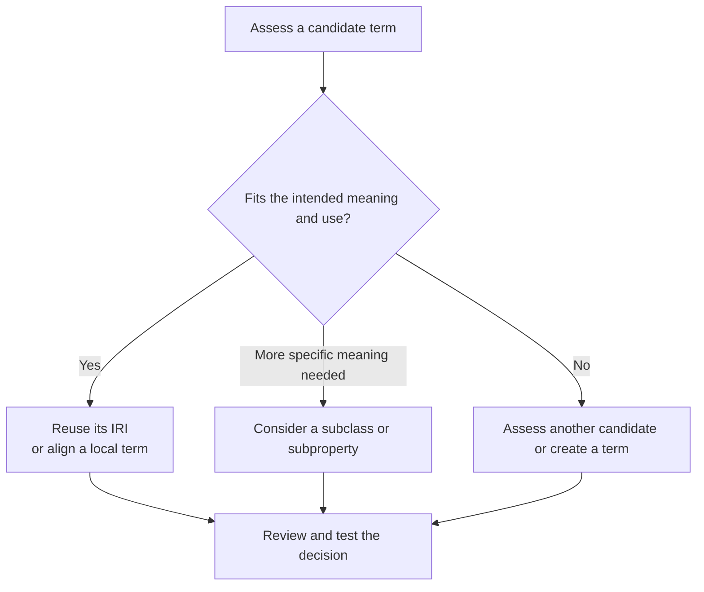

# Reuse ontologies

The bicycle inventory already uses our own classes and properties. We will compare them with existing terms and choose a combination for exchanging inventory records with another project.

:::{admonition} Learning objectives
:class: note

By the end of this chapter, you will be able to:

- Explain why and when to reuse existing ontologies and vocabularies.
- Find suitable ontologies, vocabularies and terms using standard resources.
- Assess a term's meaning and logical consequences before reusing or mapping it.
- Compare combinations of ontologies for coverage and compatibility.
- Decide what to reuse or extend and when new terms or an ontology are needed.
- Choose a reuse or mapping approach and explain its consequences.
- Explain how a SHACL information model combines reused and newly defined classes and properties.
:::

## Why reuse?

Reusing terms can help researchers combine descriptions across datasets and use definitions already developed by a community. Mapping connects terms when projects retain their own ontologies. Both require agreement about meaning: a useful match depends on what the research data describes and how it will be used. {cite}`w3c2017dwbp`

## Find existing ontologies and terms

Start with ontologies used by your research community and terms found in relevant datasets. In RDF data, follow the class and property IRIs to find their definitions.

These resources help locate candidate terms:

| Resource | What to look for |
|---|---|
| [W3C standards and specifications](https://www.w3.org/TR/) | Published vocabularies such as DCAT for dataset descriptions and PROV-O for provenance; check each document's status |
| Community specifications and de facto standards | Models used by relevant research communities, repositories or collaborators; follow their term IRIs to the publisher's documentation |
| [Linked Open Vocabularies (LOV)](https://lov.linkeddata.es/) | Vocabulary and term records, with links to definitions and publishers |
| [Schema.org](https://schema.org/docs/schemas.html) | Broad terms for describing things such as people, organisations, datasets and products on the Web |

A controlled vocabulary may also supply individual concepts to use as values, such as a language or material identifier.

For measurements, [QUDT](https://www.qudt.org/pages/QUDToverviewPage.html) and the [Ontology of units of Measure (OM)](https://github.com/HajoRijgersberg/OM) provide models and vocabularies for quantities and units. The {ref}`massKg example <owl-data-ranges>` fixes the unit as kilograms. Recording each numeric value with its unit explicitly supports combining measurements from sources that use different units.

## Assess existing ontologies and terms

Assessing an existing ontology involves considering:

- Whether its definitions, relationships and logical statements fit your intended meaning and level of detail.
- Whether relevant research communities or collaborating projects use it.
- Whether documentation, a licence and information about maintenance and versions are available.

[OntoChoice](https://ontochoice.github.io/choosing-terms-and-ontologies/) is a community project developing guidance for choosing terms and ontologies. Its [working document](https://docs.google.com/document/d/1vb-icDRYCffAn1z2jK5DmNXiYMmO9bKcri4JC9FpXuc/edit) collects evaluation criteria and suggests an order for applying them: check essential requirements first, then compare suitable candidates using criteria relevant to the research purpose.

Use labels to find candidates, then read their definitions and logical statements to check the intended meaning. {cite}`w3c2017dwbp,w3c2014linkeddata`

Check a property's direction, domains, ranges, restrictions and characteristics. For example, if F001 is the subject of a statement whose property has domain Bicycle, reasoning also classifies that frame as a Bicycle. Multiple RDFS domains or ranges apply together, as explained in {ref}`chapter 5 <owl-property-axioms>`.

Vocabularies can follow different conventions. Schema.org uses `domainIncludes` and `rangeIncludes` to describe expected uses; these differ from the RDFS domain and range axioms used in our ontology. [Schema.org data model](https://schema.org/docs/datamodel.html)

## Select a complementary set of ontologies

Aim for the smallest practical set of ontologies that together covers the dataset's required concepts, relationships and values. Compare what each candidate adds to the combination; where coverage and fit are comparable, prefer fewer ontologies. [Combined coverage of ontology sets](https://link.springer.com/article/10.1186/s13326-017-0128-y)

Coverage includes the structure needed for the intended uses. For the frame-material question, the selected terms must let us connect each bicycle to its frame and that frame to its material.

Suppose a collaborating project expects Dublin Core's `dcterms:identifier` for inventory codes and Schema.org's `schema:color` for colours. Schema.org also offers an [`identifier` property](https://schema.org/identifier). These combinations all use our bicycle ontology for the bicycle, frame and material relationships:

| Vocabularies used in the records | Inventory identifier | Colour |
|---|---|---|
| Bicycle ontology + Dublin Core | `dcterms:identifier` | `def:hasColour` |
| Bicycle ontology + Schema.org | `schema:identifier` | `schema:color` |
| Bicycle ontology + Dublin Core + Schema.org | `dcterms:identifier` | `schema:color` |

All three combinations cover these meanings. We choose the third for this exchange because it uses both property IRIs expected by the collaborator. Without that requirement, one of the two-vocabulary options may be sufficient.

Check how the models fit together: their assumptions, levels of detail, property directions, units and representation of values. Where their coverage overlaps, choose which terms to use and assess any alignments needed. The {ref}`reasoning checks <owl-reasoning>` and {ref}`competency-question tests <competency-question-tests>` help review the combined model's consequences and answers. [Integrating reused ontologies](https://arxiv.org/html/2011.12599v1)

Record which required meanings the combination covers, what each ontology contributes, and any gaps or unresolved connections.

## Decide what to reuse, extend or create

Use the remaining gaps to decide which meanings need new definitions. Then decide how the chosen terms will form project records. New term definitions can be used alongside reused terms in the same records. {cite}`noy2001ontology`

Reuse an existing term when its meaning and consequences fit the research need. A more specific meaning can justify a new subclass or subproperty of a suitable broader term. When none of the assessed terms expresses the required meaning, request a term from an appropriate ontology's maintainers or define a local term with a documented reason.

Publish new terms and logical statements in an existing project ontology when they fit its scope. A separate ontology can be appropriate when the terms serve a different purpose or need separate maintenance. Our bicycle ontology, for example, groups local classes, frame relationships and steel-frame definitions into a reusable model. If the assessed models describe the domain in a way that does not fit the research purpose, a project can develop its own model while reusing suitable external terms. {cite}`noy2001ontology`

A project-specific information model specifies how the terms form records: which properties are used, how many values are expected and how resources are linked. Where existing terms already provide all the needed meanings, SHACL shapes can express these choices using those terms' IRIs. The model can also include newly defined terms from a project ontology, as in the {ref}`SHACL example below <reuse-information-model>`. [Selecting terms and defining an application profile](https://www.dublincore.org/specifications/dublin-core/profile-guidelines/)

The flowchart summarises the decision for an individual term:

<div role="img" aria-label="Assess a candidate term's meaning and use. Reuse its IRI or consider a justified alignment if it fits; extend it if the required meaning is more specific. If it does not fit, assess another candidate or create a new term. Review and test the decision.">



</div>

If one ontology fits the central concepts and research purpose, it can serve as a *reference ontology*: the main model you reuse and extend, adding suitable terms from other models where needed. {cite}`noy2001ontology` For example, the W3C's [Organization Ontology (ORG)](https://www.w3.org/TR/vocab-org/) provides a core model for organisations that projects can extend with their own distinctions.

An *ontology design pattern* captures a reusable solution to a recurring modelling problem. The optional {ref}`role-assignment example in chapter 5 <owl-roles-context>` follows such a pattern: an individual connects an organisation, its role, the project and the relevant period. A pattern can provide existing classes and properties to reuse, or a structure to adapt to a research domain. Check that its assumptions fit the research need and that it supports the expected inferences. [Pattern reuse](https://arxiv.org/html/2011.12599v1)

Existing models can also be adapted or merged into a new ontology. Merging combines terms and axioms from two or more source ontologies and may require resolving overlaps and conflicting modelling choices. [Ontology adaptation and merging, sections 2 and 5](https://research-archive.stem.open.ac.uk/stemra-data/uploads/sites/136/2025/03/NeOn_2010_D543.pdf)

(reuse-decision-record)=
Record the chosen term IRIs, sources, versions and reasons for the choice, including alternatives that were rejected. Use this record when reviewing updates: a mapping may need revision when either model changes.

## Reuse existing terms and import ontologies

Direct reuse means using an existing term's IRI. The ontology header already does this with `dcterms:title` and `dcterms:license`.

A metadata table can record which existing property describes each field, alongside the field's local name. For example:

| Metadata field | Property IRI |
|---|---|
| Inventory identifier | `http://purl.org/dc/terms/identifier` |
| Colour | `https://schema.org/color` |

The same IRIs can then be used as properties when expressing those records in RDF. [Selecting metadata terms](https://www.dublincore.org/specifications/dublin-core/profile-guidelines/)

For example, [Schema.org's Vehicle](https://schema.org/Vehicle) covers devices designed or used to transport people or cargo. Its [color property](https://schema.org/color) records a product's colour as text. A separate description of B001 could use these terms:

```turtle
@prefix id: <https://w3id.org/bicycle-ontology/id/> .
@prefix schema: <https://schema.org/> .

id:B001 a schema:Vehicle ;
    schema:color "blue"@en .
```

The shared IRI for B001 lets us combine this description with the bicycle inventory. The statements say that B001 is a Vehicle and has the colour blue. Our frame relationships provide the detail needed for the frame-material question.

Direct reuse avoids maintaining a local term for the same meaning. It also makes your data depend on the external definition and its maintenance. Using the publisher's exact IRI, including its HTTP or HTTPS scheme, connects the data to that term; a different spelling gives a different IRI, which can prevent queries from matching the data.

For values drawn from controlled vocabularies, a selected term's IRI can be the object of an appropriate relationship, while its label serves for display. Reusing that IRI connects records even when their display labels use different languages. [Reusing vocabularies](https://www.w3.org/TR/dwbp/#ReuseVocabularies)

(owl-imports)=
An `owl:imports` statement brings another ontology's axioms into reasoning, including those of its imports. Using its term IRIs alone does not import their defining axioms. An import can refer to a particular version using its version IRI. [Ontology imports](https://www.w3.org/TR/owl2-syntax/#Imports)

The supplied example keeps reusable definitions in `bicycle-ontology.ttl` and records in `bicycle-example-data.ttl`. The latter contains:

```turtle
@prefix owl: <http://www.w3.org/2002/07/owl#> .

<https://w3id.org/bicycle-ontology/examples/> a owl:Ontology ;
    owl:imports <https://w3id.org/bicycle-ontology/> .
```

To inspect this import in Protégé:

1. Keep `bicycle-ontology.ttl`, `bicycle-example-data.ttl` and `catalog-v001.xml` in the same folder. The {ref}`chapter 5 file guide <course-example-files>` provides the downloads.
2. Open `bicycle-example-data.ttl`. In **Active ontology**, inspect **Imported Ontologies**. The entry should show the ontology IRI and a local source location resolved through `catalog-v001.xml`. A failed import shows only its IRI. [Imported Ontologies view](https://protegeproject.github.io/protege/views/imported-ontologies/)
3. Choose **View > Render by prefixed name**. In **Entities > Classes**, inspect `def:Bicycle` and its `def:Vehicle` superclass. The records file uses these terms; their definitions come from the imported ontology.
4. Select **Reasoner > HermiT**, then **Reasoner > Start reasoner**.
5. In **DL Query**, enter `def:BicycleWithSteelFrame`, select **Instances** and choose **Execute**. Expect B001 and its alias C17, using the imported steel-frame definition and the sample records. [DL Query instructions](https://protegewiki.stanford.edu/wiki/DLQueryTab)

To add an import to a working ontology, use **+** beside **Direct imports** in **Active ontology**. In the import wizard, choose the local-file option and select the ontology file. Check the ontology IRI and source location before finishing. Protégé adds `owl:imports` to the working ontology and records the local file location in `catalog-v001.xml`. [Import wizard and catalogs](https://protegewiki.stanford.edu/wiki/Importing_Ontologies_in_P41)

An import provides the axioms needed for these inferences, while keeping the files separate. The chosen reasoner must support those axioms. Record which versions produced the expected results, and review updates to an imported ontology before adopting them.

When only part of an ontology is relevant, a project can extract an *ontology module*: selected terms and supporting axioms from the source ontology. The module retains the source term IRIs and can be imported separately. The extraction method determines which relationships and logical consequences are preserved. ROBOT's locality-based methods preserve logical consequences for the selected vocabulary. Its MIREOT method extracts a selected hierarchy. Record the source version and extraction method so the module can be reviewed and updated. [Ontology module extraction](https://robot.obolibrary.org/extract)

Axioms that work separately can produce unintended classifications or contradictions when combined through imports and mappings. The {ref}`reasoning checks <owl-reasoning>` and {ref}`competency-question tests <competency-question-tests>` let us compare the combined model's inferences and answers with the expected results for representative records. [Combined axioms through imports](https://www.w3.org/TR/owl2-syntax/#Imports)

## Extend with subclasses and subproperties

Extension adds a local distinction using a subclass or subproperty relationship. For example, if our Bicycle class fits Schema.org's Vehicle definition:

```turtle
@prefix def: <https://w3id.org/bicycle-ontology/def/> .
@prefix rdfs: <http://www.w3.org/2000/01/rdf-schema#> .
@prefix schema: <https://schema.org/> .

def:Bicycle rdfs:subClassOf schema:Vehicle .
```

Read the statement as “Every Bicycle is a Schema.org Vehicle”. With RDFS inference, B001's Bicycle type therefore also gives it the Schema.org Vehicle type. The reverse does not follow. Likewise, `rdfs:subPropertyOf` is suitable when every use of the local property also expresses the broader external relationship. The {ref}`hasFrame/hasComponent example <owl-property-axioms>` shows this direction.

Our local Bicycle class keeps its definition and becomes a subclass of Schema.org's Vehicle. With the external axioms available for reasoning, a subproperty inherits the typing consequences of its superproperty's domains and ranges. Check these consequences before adopting the extension. [Class and property hierarchies](https://www.w3.org/TR/owl2-primer/#Property_Hierarchies)

## Align classes and properties

*Alignment* records a relationship between terms, including newly defined local classes or properties and terms in other ontologies. The Bicycle–Vehicle axiom above is both an extension and an alignment: it expresses a local distinction and relates it to an external class.

Subclass and subproperty axioms can express a narrower meaning; `owl:equivalentClass` and `owl:equivalentProperty` express equivalence in both directions. Equivalent classes have the same members. Equivalent properties have the same subject–object pairs. [OWL equivalence](https://www.w3.org/TR/owl2-primer/#Classes.2C_Properties.2C_and_Individuals_.E2.80.93_And_Basic_Modeling_With_Them)

Alignment lets projects retain their own terms while making their relationships explicit. Choose the direction and strength of a mapping by checking its inferences. With subclass reasoning, the Bicycle–Vehicle mapping includes Bicycles in queries for Schema.org Vehicles. Equating these classes would also classify every Schema.org Vehicle as a Bicycle.

Use equivalence only when that relationship holds across the intended uses of both terms. Our `hasColour` records colour using language-tagged text; Schema.org's `color` describes a product's colour as text. A component can also be a product, and Schema.org permits properties on additional types. [Schema.org data model](https://schema.org/docs/datamodel.html)

Equating these properties would make every `schema:color` assertion also a `def:hasColour` assertion, and conversely. Our property's domain and range consequences would then apply to Schema.org colour assertions too. For the inventory exchange, direct reuse of `schema:color` supplies the agreed colour field.

For individuals, `owl:sameAs` asserts that two IRIs identify the same thing, as with B001 and C17. An identity claim needs justification: similar names or related concepts alone do not establish identity.

(reuse-information-model)=
## Combine terms in a SHACL information model

An *application profile* specifies how selected vocabulary terms are used in the inventory records. [Application profiles](https://www.dublincore.org/specifications/dublin-core/profile-guidelines/)

For the inventory exchange described earlier, we can combine Dublin Core's `dcterms:identifier`, Schema.org's `schema:color` and our ontology's Bicycle, Frame, hasFrame and hasMaterial terms. The {ref}`hasFrame property <owl-property-axioms>` provides a specific link to the frame, alongside the more general component relationships. A separate project description of B001 could be:

```turtle
@prefix dcterms: <http://purl.org/dc/terms/> .
@prefix def: <https://w3id.org/bicycle-ontology/def/> .
@prefix id: <https://w3id.org/bicycle-ontology/id/> .
@prefix schema: <https://schema.org/> .

id:B001 a def:Bicycle ;
    dcterms:identifier "B001" ;
    schema:color "blue"@en ;
    def:hasFrame id:F001 .

id:F001 a def:Frame ;
    def:hasMaterial "steel"@en .
```

The identifier property records the inventory code as text; the resource still uses its shared IRI. [Dublin Core identifier](https://www.dublincore.org/specifications/dublin-core/dcmi-terms/#http://purl.org/dc/terms/identifier)

For this project, a bicycle description has one inventory identifier, at least one colour and one frame link. A frame's material is optional and uses language-tagged text when recorded. `BicycleDescription` and `FrameDescription` are *node shapes* that group the fields of bicycles and frames. Each `sh:property [ ... ]` block describes one field using an unnamed property shape. `sh:maxCount 1` allows at most one value for that field. [SHACL shapes](https://www.w3.org/TR/shacl/#shapes)

```turtle
@prefix dcterms: <http://purl.org/dc/terms/> .
@prefix def: <https://w3id.org/bicycle-ontology/def/> .
@prefix rdf: <http://www.w3.org/1999/02/22-rdf-syntax-ns#> .
@prefix schema: <https://schema.org/> .
@prefix sh: <http://www.w3.org/ns/shacl#> .
@prefix shape: <https://w3id.org/bicycle-ontology/shape/> .
@prefix xsd: <http://www.w3.org/2001/XMLSchema#> .

shape:BicycleDescription a sh:NodeShape ;
    sh:targetClass def:Bicycle ;
    sh:property [ sh:path dcterms:identifier ;
        sh:datatype xsd:string ;
        sh:minCount 1 ;
        sh:maxCount 1 ] ;
    sh:property [ sh:path schema:color ;
        sh:datatype rdf:langString ;
        sh:minCount 1 ] ;
    sh:property [ sh:path def:hasFrame ;
        sh:class def:Frame ;
        sh:node shape:FrameDescription ;
        sh:minCount 1 ;
        sh:maxCount 1 ] .

shape:FrameDescription a sh:NodeShape ;
    sh:property [ sh:path def:hasMaterial ;
        sh:datatype rdf:langString ] .
```

Here, each `sh:path` names the property used for a field, following the notation introduced in {ref}`chapter 2 <shacl-basics>`. On the `hasFrame` field, `sh:class def:Frame` sets the expected type of the linked resource. The `sh:node shape:FrameDescription` statement uses the frame shape to describe that resource's fields. This connects the bicycle and frame record structures. [Linked shapes](https://www.w3.org/TR/shacl/#NodeConstraintComponent)

The classes and properties retain the meanings defined in their ontologies; the shapes specify their use in this inventory. This gives the project a common record structure built from reused and locally defined terms. Changes to that structure require maintaining the profile and the applications that use it. Kadaster uses a similar distinction between reusable knowledge and an organisation-specific SHACL information model. [Kadaster's modelling approach, section 4](https://ceur-ws.org/Vol-2977/paper3.pdf)

A profile can use external terms directly alongside local extensions and alignments. Review the statements and their inferences with domain experts. Test records that should match and records that should remain outside the match to identify mappings that are too broad. Add each mapping's direction to the {ref}`decision record <reuse-decision-record>` for later maintainers.
