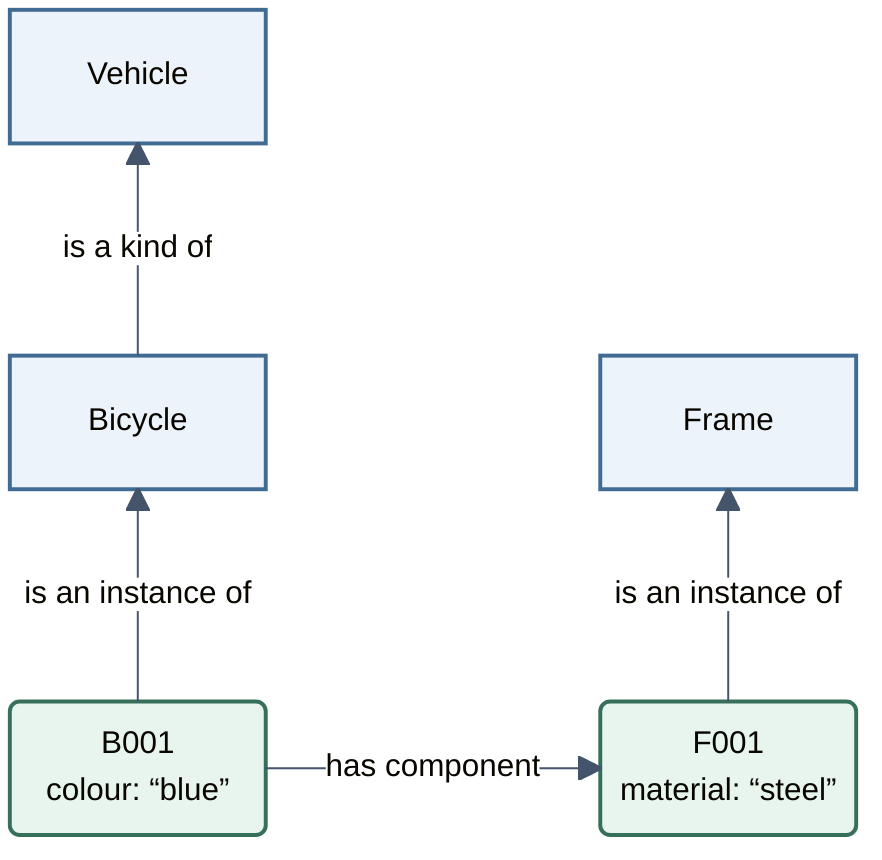

(running-example)=
# Running example: bicycles

We will use a bicycle inventory throughout the training.

## The bicycle

B001 is our fictional blue cargo bicycle, or *bakfiets*. It has two wheels, a cargo box and a steel frame, identified as F001. Cargo bicycles are designed to carry loads in addition to the rider, such as shopping, passengers or pets.

## Our question

Which bicycles have steel frames?

To answer this, we need to connect each bicycle to its frame and record the frame's material. The cargo box may be made of a different material.

## A first model

The diagram shows B001 and its frame. Read each arrow in its direction to make a sentence. Colour and material are recorded inside the individual boxes.

*Bicycle*, *Vehicle* and *Frame* are classes: they describe kinds of things. Bicycle is a subclass of Vehicle, so every bicycle is a vehicle.

B001 and F001 are individuals: a particular bicycle and its particular frame. B001 is an instance of Bicycle; F001 is an instance of Frame. Because every bicycle is a vehicle, B001 is also a vehicle.

Properties connect these individuals to other individuals or to values. “Has component” links B001 to F001. “Colour” connects B001 to “blue”; “material” connects F001 to “steel”.

A frame is part of a bicycle; a bicycle is a kind of vehicle. The model uses different relationships for these meanings.

We can now answer our question: B001 has component F001, which is a frame made of steel. B001 is therefore a bicycle with a steel frame.

Next: [Linked data foundations](linked-data-foundations.md).
